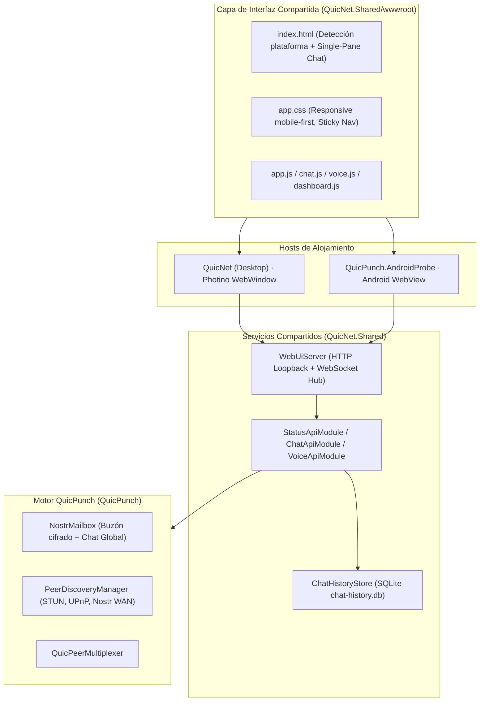
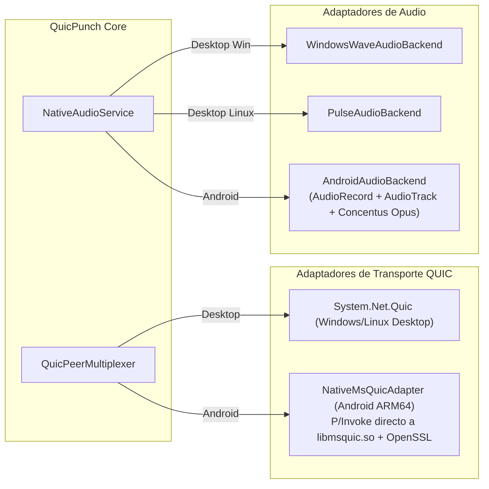

# Plan de implementación de QuicPunch para Android

Actualizado: 2026-09-30.  
Documento maestro de arquitectura, análisis de causa raíz y traspaso técnico para el desarrollo y depuración de QuicPunch en Android.

### Avance verificado el 2026-09-30

| Área | Estado actual |
| --- | --- |
| Historial de chat | Implementado `GET /api/chat/messages` con paginación por cursor y lectura SQLite por conversación; `chat.js` carga páginas sin depender de `/api/status?include=chat`. Los peers guardados se muestran aunque no haya descubrimiento de red. |
| Reinicio sin Internet | Probado en un OnePlus 9 con `am force-stop` y modo avión: el Chat Global y los mensajes directos guardados se renderizaron. Se corrigió además un error de `/api/status` cuando no existe un endpoint WAN. |
| Audio Android | Llamada Android–Windows establecida y audio audible confirmado por el usuario. `AudioRecord`/`AudioTrack` y Opus comparten señalización, códec y datagramas con escritorio. Búfer activo de reproducción Android verificado en 40 ms, frente a unos 120 ms anteriores; cola compartida limitada a 60 ms. Falta medir latencia acústica de extremo a extremo. |
| Recuperación Nostr y LAN | El canal global relee dos horas al reconectar; las pruebas de NAT y buzón pasan. Las IP del mismo segmento local se priorizan entre los candidatos de conexión. |
| QUIC Android | **Verificado en dispositivo real** mediante `AndroidMsQuicTransport` y `native/qp_transport.c`: MsQuic/OpenSSL nativos evitan la ruta incompatible de `System.Net.Quic`. Chat directo bidireccional, streams, datagramas de voz y telemetría operativos. TLS negoció `X25519MLKEM768` (4588); la identidad sigue usando certificados ECDSA P-256. |
| Voz/vídeo, velocidad y QuicWatch entre peers | Voz y prueba breve de velocidad bidireccional verificadas entre Android y Windows. Vídeo, compartir pantalla completo y QuicWatch siguen pendientes de validación/implementación específica según capacidad; no asumir que una llamada de voz los valida. VPN Android excluida. |
| Segundo plano y estabilidad | Nodo y servidor local alojados en `AndroidConnectionService` con notificación y acción Desconectar. Sesiones mantenidas al pasar a segundo plano y durante muestras con pantalla apagada. Corregido bloqueo de monitores durante espera nativa QUIC y publicación prematura de `WebUiServer`. Faltan pruebas prolongadas de Doze, cambios Wi-Fi/datos y recuperación WAN. |
| Instalación en Android 16 | Probado en OnePlus CPH2769 (API 36): el APK antiguo de 12 MB en `bin/Debug/net11.0-android/` carecía de `libassembly-store.so` y abortaba con `Failed to initialize CoreCLR (80070002)`. El build ahora copia allí el APK ARM64 completo de 49 MB. Instalación y `GET /api/status` (HTTP 200) verificados en el teléfono nuevo. |

Las secciones posteriores conservan el diagnóstico histórico y el trabajo previsto. Las afirmaciones sobre QUIC/audio ausentes deben leerse como antecedentes, no como estado actual. El registro [verification-2026-09-30.md](verification-2026-09-30.md) recoge las pruebas y las limitaciones actuales.

---

## 1. Resumen Ejecutivo y Estado Comprobado

### 1.1 Estado comprobado en hardware real (OnePlus 9 ARM64, Android API 34)
- **Solución y compilación unificada**: `QuicPunch.AndroidProbe` y `QuicPunch.AndroidProbe.Desktop` están plenamente integrados en `QuicPunch.slnx`. Todos los proyectos (`QuicPunch`, `QuicPunch.Vpn`, `QuicPunch.NativeBuilder`, `QuicNet`, `QuicNet.Shared`, `QuicPunch.AndroidProbe`, `QuicPunch.AndroidProbe.Desktop`, `QuicPunchTests`) compilan cleanly.
- **Frontend unificado sin duplicación**: `QuicNet.Shared/wwwroot/` es la única fuente de verdad. `QuicNet.Shared` embebe los recursos directamente. `WebUiServer` inyecta automáticamente la clase de plataforma (`platform-android` / `platform-desktop`) en `document.documentElement` antes de renderizar (cero FOUC).
- **Interfaz responsiva adaptada a móvil**:
  - Viewport optimizado para pantallas táctiles y teclado virtual (`width=device-width, initial-scale=1.0, maximum-scale=1.0, user-scalable=no, viewport-fit=cover, interactive-widget=resizes-content`).
  - Cabecera compacta sticky (48px) y barra de navegación horizontal táctil con scroll suave.
  - Diseño de chat en panel único estilo WhatsApp/Telegram: lista de conversaciones al abrir; al pulsar un peer se oculta la lista y se expande el chat con botón `[←]` para regresar.
  - Banner informativo en QuicWatch que refleja transparentemente que el servicio está planificado.
- **Chat P2P real verificado en vivo**:
  - Mensajería bidireccional mediante la red descentralizada Nostr WAN y almacenamiento SQLite local (`chat-history.db`) verificado entre el teléfono Android (`echo_scout12@DESKTOP-YUJRIVM`, IP `192.168.5.79`) y el nodo de escritorio (`SFOT1NQIKH`, IP `192.168.5.2`).
  - Identidad criptográfica persistente (`wan_identity.bin`, `nostr_mailbox.state`, `peers.db`) en el almacenamiento privado de Android (`/data/user/0/org.quicpunch.androidprobe/files`).

---

## 2. Diagnóstico Detallado de Problemas Detectados y Causa Raíz

### 2.1 Problema 1: El sistema de llamadas no funciona e inestabilidad en túneles QUIC

#### Causa Raíz 1A: Crash en el handshake TLS de QUIC administrado (`TypeInitializationException`)
En las pruebas en vivo con el teléfono conectado, el intercambio de señalización UDP y el hole punching completan con éxito:
```text
[HOLE PUNCH] Succeeded! Nominated peer-reflexive endpoint: 192.168.5.2:36434
--- QUIC Establishment: Acting as SERVER --- LocalPort: 49050 -> Nominated Remote: 192.168.5.2:36434
[QUIC SERVER] Bound listener on port 49050. Sending QUIC_READY signal to client...
```
Sin embargo, en el instante en que el handshake QUIC se negocia, el runtime de Android arroja:
```text
09-28 21:36:37.205 E QuicPunch: [QUIC] Failure: TypeInitializationException: The type initializer for 'Crypto' threw an exception.
09-28 21:36:37.206 I QuicPunch: [FAILED] QUIC connection with SFOT1NQIKH failed to complete.
09-28 21:36:37.206 I QuicPunch: [HELLO AUTO-CONNECT] Failed for SFOT1NQIKH: Failed to establish physical QUIC tunnel with peer SFOT1NQIKH.
```
**Análisis del compilador y runtime:**
El compilador de .NET emite las advertencias explícitas:
```text
warning CA1416: 'QuicClientConnectionOptions' is only supported on: 'linux', 'macOS/OSX', 'windows'.
warning CA1416: 'QuicConnectionOptions.DefaultCloseErrorCode' is only supported on: 'linux', 'macOS/OSX', 'windows'.
```
En el runtime de .NET para Android, la capa criptográfica nativa estándar es `libSystem.Security.Cryptography.Native.Android.so` (que delega en Java/Conscrypt mediante JNI). No obstante, la implementación interna de Microsoft `System.Net.Quic` requiere explícitamente `libSystem.Security.Cryptography.Native.OpenSsl.so` para configurar las credenciales TLS y los callbacks de validación de certificados de MsQuic. Al no estar empaquetada dicha biblioteca para Android en el SDK oficial de .NET, el inicializador estático de `Interop+Crypto` falla con `DllNotFoundException`, provocando el fallo de cualquier túnel `System.Net.Quic` en Android. Una prueba con la biblioteca linux-bionic-arm64 de .NET y OpenSSL bionic confirmó que añadir los binarios no basta: el callback intenta tratar un certificado Android como un `X509` OpenSSL y termina en `SIGBUS` dentro de `X509_up_ref`. La solución requiere el adaptador nativo de transporte descrito abajo.

Por el contrario, el probe nativo (`qp_probe.c`) sí funciona en Android porque consume directamente la API en C de `libmsquic.so` y `libssl.so` compiladas con el NDK, sin pasar por la capa rota de `System.Net.Quic`.

#### Causa Raíz 1B: Motor de audio inexistente en Android (`NullAudioBackend`)
En `QuicPunch/Audio/NativeAudioService.cs` (líneas 63-75):
```csharp
if (OperatingSystem.IsLinux() && !OperatingSystem.IsAndroid())
{
    _backend = new PulseAudioBackend();
}
else if (OperatingSystem.IsWindows())
{
    _backend = new WindowsWaveAudioBackend();
}
else
{
    _backend = new NullAudioBackend();
}
```
En Android, el servicio selecciona `NullAudioBackend`. En este backend:
- `StartCapture()` devuelve `false` (no graba del micrófono).
- `StartPlayback()` devuelve `false` (no reproduce por altavoz).
- `GetInputDevices()` devuelve `"No Audio Input Available"`.
Por tanto, aunque la llamada pudiera señalizarse, no hay captura ni reproducción de audio.

#### Causa Raíz 1C: Acoplamiento estricto de señalización de llamada al túnel QUIC
En `QuicNet.Shared/Protocols/VoiceCallHandler.cs`, la sesión de llamada (`VoiceCallSession`) requiere abrir un stream QUIC bidireccional con el protocolo `00000000-0000-0000-0000-000000000003`. Si el túnel físico QUIC falla debido a 1A, la llamada se aborta de inmediato antes de poder emitir datagramas UDP de audio.

#### Causa Raíz 1D: Hairpinning NAT en routers domésticos vs. selección directa de LAN
Cuando ambos dispositivos están en la misma red Wi-Fi (`192.168.5.2` y `192.168.5.79`), el descubrimiento anuncia tanto las IPs locales de la subred como las IPs públicas WAN (`86.127.239.61`). Si el proceso de hole punching selecciona o prioriza la dirección reflexiva pública, muchos routers residenciales descartan el tráfico de loopback (NAT hairpinning bloqueado), lo que causa retardos o fallos en el establecimiento.

---

### 2.2 Problema 2: Mensajes de Nostr no visibles al reabrir la app hasta enviar otro mensaje

#### Causa Raíz 2A: Renderizado condicional en la UI móvil (`chat.js`) — *[CORREGIDO]*
Al arrancar la aplicación, `selectedPeerId` se inicializaba por defecto en `'global'`. En el diseño móvil de panel único:
1. La vista arranca mostrando la lista de chats (sin la clase `.in-conversation`).
2. El contenedor de mensajes `#messages` se renderiza mientras tiene `display: none`.
3. Cuando el usuario pulsaba sobre la fila de "Chat Global", el evento click ejecutaba:
   ```javascript
   if (selectedPeerId !== 'global') {
       selectedPeerId = 'global';
       renderChat();
       scrollToBottom();
   }
   ```
   Dado que `selectedPeerId` **ya era** `'global'`, la condición resultaba falsa. La aplicación agregaba `.in-conversation` pero **nunca ejecutaba `renderChat()` ni `scrollToBottom()`**. El contenedor permanecía con el scroll desajustado y sin refrescar el DOM.
4. Al redactar y enviar un nuevo mensaje, el socket disparaba `onRealtimeMessage()`, el cual forzaba incondicionalmente `renderChat()`, haciendo que repentinamente aparecieran todos los mensajes anteriores.
*Solución aplicada:* Se eliminó la guarda condicional en `chat.js`, garantizando que al pulsar cualquier conversación (global o peer) se fuerce el renderizado y el desplazamiento al fondo con `renderChat(true)`.

#### Causa Raíz 2B: Filtro temporal de suscripción en relays Nostr (`since`)
En `QuicPunch/Discovery/NostrMailbox.cs`:
- Al recibir o publicar un mensaje global, se actualiza `_lastGlobalSyncTimestamp` y se guarda en `nostr_mailbox.state`.
- Al reiniciar la app, `SubscribeToGlobalChannelAsync` envía a los relays un filtro con `["since"] = LastGlobalSyncTimestamp`.
- Si el relay interpreta `since` como estrictamente mayor (`> T`), o si la conexión WebSocket con el relay aún no ha completado (arranque asíncrono en segundo plano), los mensajes anteriores no son retransmitidos por la red Nostr. El cliente depende exclusivamente de cargar la base de datos local SQLite `chat-history.db`.

#### Causa Raíz 2C: Broadcasts periódicos de estado sin historial de chat
En `QuicNet.Shared/WebUi/Modules/StatusApiModule.cs`:
- El endpoint `/api/status` solo incluye los mensajes de chat si se solicita explícitamente `?include=chat`.
- Sin embargo, las emisiones en tiempo real por WebSocket (`status_updated`) invocan `GetStatusObject()` sin parámetros (`includeChat = false`), enviando `chatMessages: []`. Si la vista de chat procesara un `status_updated` general sin verificar, sobreescribiría el historial cargado.

---

## 3. Arquitectura del Sistema

### 3.1 Arquitectura Unificada Actual


### 3.2 Arquitectura Objetivo para Transporte y Audio en Android


---

## 4. Hitos de Implementación y Tareas Concretas para Futuros Desarrolladores

### Hito 1: Adaptador Nativo de Transporte QUIC para Android (`NativeMsQuicAdapter`)
*Objetivo:* Resolver el bloqueo de `TypeInitializationException` en `System.Net.Quic` implementando un transporte que invoque directamente `libmsquic.so` en Android.

**Estado de implementación el 29-09-2026:** el descubrimiento, el handshake UDP y la selección de ruta P2P alcanzaron la fase QUIC en un OnePlus CPH2769; una prueba registró `HOLE PUNCH Succeeded` con el PC. La APK anuncia la IP Wi-Fi real (`192.168.5.85`). Después de esa prueba se integró `AndroidMsQuicTransport` con `qp_transport.c`: TLS nativo con pin exacto del certificado DER, listener y cliente, streams, datagramas, endpoint y telemetría. La prueba del mismo puente compilado para Linux pasa conexión, rechazo de certificado distinto, intercambio de streams en ambos sentidos y datagramas. La APK ARM64 compila, pero la versión integrada todavía requiere una prueba de sesión completa Android-PC en un teléfono. El dispositivo anterior mostró errores UDP `AccessDenied` intermitentes y una interfaz `vgate0`; revisar sus políticas VPN/red si reaparecen. La lista de tareas que sigue describe el diseño original y sirve de referencia histórica; el trabajo pendiente del hito es validación real y corrección de cualquier fallo observado allí.

1. **Definir la abstracción de transporte QUIC**:
   - Crear la interfaz `IQuicConnectionTransport` en `QuicPunch/Multiplexer/` con las operaciones fundamentales:
     - `AcceptStreamAsync(CancellationToken)`
     - `OpenBidirectionalStreamAsync(CancellationToken)`
     - `SendDatagramAsync(ReadOnlyMemory<byte>)`
     - `ReceiveDatagramAsync(CancellationToken)`
     - `DisposeAsync()`
   - Adaptar `System.Net.Quic.QuicConnection` para implementar `IQuicConnectionTransport` en escritorio.
2. **Implementar `NativeMsQuicTransport` para Android**:
   - Reutilizar las declaraciones P/Invoke probadas en `QuicProbe.cs` y `qp_probe.c`.
   - Inicializar la tabla de funciones de MsQuic (`MsQuicOpenVersion(2, &Registration)`).
   - Configurar credenciales TLS (`ConfigurationOpen` con ALPN `"quic-punch"`, `"h3"`).
   - Implementar el callback de validación de certificados del peer (`QUIC_STATUS_VALIDATE_CERTIFICATE`) comparando el hash SHA-256 del certificado con la identidad conocida en `PeerStore`, sin depender de la cadena de confianza del sistema operativo ni de `System.Security.Cryptography.Native.OpenSsl`.
3. **Integración en `QuicPunchConnection.cs`**:
   - En `InitQuicConnectionCore`:
     ```csharp
     if (OperatingSystem.IsAndroid())
     {
         return await NativeMsQuicConnection.ConnectAsync(remoteEndpoint, certHash, ...);
     }
     else
     {
         return await TryRunClient(...);
     }
     ```
4. **Criterio de aceptación:**
   - La prueba en logcat muestra establecimiento exitoso del túnel físico: `[SUCCESS] QUIC connection established with SFOT1NQIKH! Path MTU: ... bytes` sin excepciones de tipo `Crypto`.

---

### Hito 2: Motor de Audio Nativo para Android (`AndroidAudioBackend`)
*Objetivo:* Dotar a Android de captura y reproducción de voz en tiempo real con códec Opus para Voice Studio.

1. **Crear `AndroidAudioBackend.cs` implementando `INativeAudioBackend`**:
   - Ubicación: `QuicPunch/Audio/AndroidAudioBackend.cs` (compilado condicionalmente bajo `net11.0-android` o en `QuicPunch.AndroidProbe`).
2. **Captura de micrófono (`AudioRecord`)**:
   - Frecuencia de muestreo: 48,000 Hz, canal mono, codificación PCM 16 bits.
   - Tamaño de buffer: 960 muestras por frame (20 ms a 48 kHz = 1920 bytes).
   - Bucle asíncrono de lectura con hilo prioritario (`ThreadPriority.UrgentAudio`) que entrega los buffers a `OpusVoiceCodec.Encode()`.
3. **Reproducción por altavoz (`AudioTrack`)**:
   - Instanciar `AudioTrack` mediante `AudioTrack.Builder` en modo `AudioTrackMode.Stream`, uso `AudioUsageKind.VoiceCommunication`.
   - Jitter buffer y mezcla en `NativeAudioService.MixerLoop`: desempaqueta tramas Opus y escribe los bloques PCM decodificados en `AudioTrack.Write()`.
4. **Permisos y enrutamiento de audio**:
   - Validar permisos en tiempo de ejecución: `RECORD_AUDIO`, `MODIFY_AUDIO_SETTINGS`.
   - Manejo de audio focus mediante `AudioManager.RequestAudioFocus` para pausar/reanudar en llamadas entrantes del teléfono.
5. **Criterio de aceptación:**
   - Al unirse a una llamada en Voice Studio entre Android y PC, se escucha audio claro y bidireccional en ambos sentidos sin latencia perceptible (< 60 ms en LAN).

---

### Hito 3: Resiliencia de Señalización y Conexión LAN/P2P
*Objetivo:* Evitar dependencias rígidas y fallos por NAT hairpinning en entornos locales.

1. **Priorización de candidatos de red (RFC 8445 / ICE)**:
   - En `QuicPunchConnection.BuildProbeTargets`:
     - Si ambos peers comparten la misma subred IPv4 (ej. `192.168.5.x`), priorizar las direcciones LAN locales sobre los candidatos reflexivos públicos (`ServerReflexive`).
     - Descartar candidatos WAN redundantes cuando se confirme conectividad por LAN directa para evitar saturar el router con paquetes de hairpinning.
2. **Señalización híbrida para llamadas de voz**:
   - En `VoiceCallHandler`: si el túnel QUIC principal está en reconexión o migración, permitir que los paquetes de control de llamada (`CallOffer`, `CallAnswer`, `Hangup`) viajen mediante datagramas autenticados QuicPunch o mensajes Nostr en tiempo real.
3. **Criterio de aceptación:**
   - Dos dispositivos en la misma red Wi-Fi se conectan en menos de 500 ms directamente por sus IPs privadas sin requerir apertura de puertos WAN.

---

### Hito 4: Persistencia y Sincronización del Historial de Chat
*Objetivo:* Garantizar disponibilidad total de conversaciones históricas en Android en cualquier escenario de apagado de la app.

1. **Ventana de lookback en NostrMailbox**:
   - En `NostrMailbox.cs` (`SubscribeToGlobalChannelAsync`):
     ```csharp
     // Aplicar ventana de tolerancia de 2 horas sobre el último timestamp guardado
     long since = Math.Max(0, LastGlobalSyncTimestamp - 7200);
     ```
   - Filtrar duplicados mediante la clave primaria `(peer_id, message_id)` en `ChatHistoryStore.Save()`.
2. **Ciclo de vida Android y SQLite WAL flush**:
   - `ChatHistoryStore.Save()` ya escribe mediante SQLite con una conexión que se cierra al terminar cada operación y tiene clave primaria `(peer_id, message_id)`. Comprobar la durabilidad al cerrar la app bruscamente y al reiniciarla sin red. No depender de `OnPause`/`OnStop`: `am force-stop` puede matar el proceso sin ejecutar esos callbacks. Evaluar un checkpoint WAL solo si una medición demuestra que hace falta; no hacerlo en cada pausa por defecto.
3. **Endpoint dedicado de mensajes**:
   - Exponer `GET /api/chat/messages?peerId=...&limit=50&before=...` en `QuicNet.Shared/WebUi/Modules/ChatApiModule.cs`; `peerId=global` identifica Chat Global. Leer de `ChatHistoryStore` con consulta parametrizada, orden estable por `(timestamp_ms, message_id)` y cursor `before` opaco o documentado. Limitar `limit` en el servidor, excluir mensajes caducados/ocultos y devolver un cursor para la página anterior.
   - Cambiar `QuicNet.Shared/wwwroot/chat.js` para cargar la página reciente al abrir cada conversación, solicitar páginas anteriores al desplazarse y fusionar eventos `chat_msg` sin duplicados por `(peerId, msgId)`. El historial deja de depender de `/api/status?include=chat`; los eventos `status_updated` no deben vaciar la lista local. Mantener una migración compatible con la UI de escritorio.
4. **Criterio de aceptación:**
   - Con mensajes ya persistidos, ejecutar `am force-stop`, cortar Internet y reabrir la app: la primera página del Chat Global y de cada chat directo aparece desde SQLite sin esperar al relay ni enviar otro mensaje. Las páginas antiguas se recuperan al desplazarse hasta completar **todos** los mensajes persistidos no caducados. Repetir tras un nuevo mensaje y comprobar ausencia de duplicados, orden estable y que un `status_updated` no borra el historial.

---

## 5. Guía Rápida para el Desarrollador: Cómo Compilar y Probar

### Requisitos
- Windows 10/11 con .NET 11 Preview SDK (`11.0.100-preview.7+`).
- Android SDK (API 35+), NDK r27c y JDK 21 para reproducir el build descrito en `QuicPunch.AndroidProbe/README.md`:
  - `$env:LOCALAPPDATA\Android\Sdk`
  - `$env:JAVA_HOME`
- Dispositivo físico Android conectado por USB con depuración habilitada (`adb devices`).

### Comandos de Compilación y Despliegue
```powershell
# 1. Compilar la solución completa en Visual Studio o por consola:
dotnet build QuicPunch.slnx -c Debug

# 2. Compilar y empaquetar el APK de Android:
dotnet build QuicPunch.AndroidProbe/QuicPunch.AndroidProbe.csproj -c Debug -p:AndroidSdkDirectory="$env:LOCALAPPDATA/Android/Sdk" -p:JavaSdkDirectory="$env:JAVA_HOME"

# 3. Instalar en el dispositivo conectado:
& "$env:LOCALAPPDATA\Android\Sdk\platform-tools\adb.exe" install -r "QuicPunch.AndroidProbe\bin\Debug\net11.0-android37.0\org.quicpunch.androidprobe-Signed.apk"

# 4. Lanzar la actividad principal sin depender del nombre generado de la clase:
& "$env:LOCALAPPDATA\Android\Sdk\platform-tools\adb.exe" shell monkey -p org.quicpunch.androidprobe 1

# 5. Monitorear logs del motor QuicPunch:
& "$env:LOCALAPPDATA\Android\Sdk\platform-tools\adb.exe" logcat -s QuicPunch:*
```
