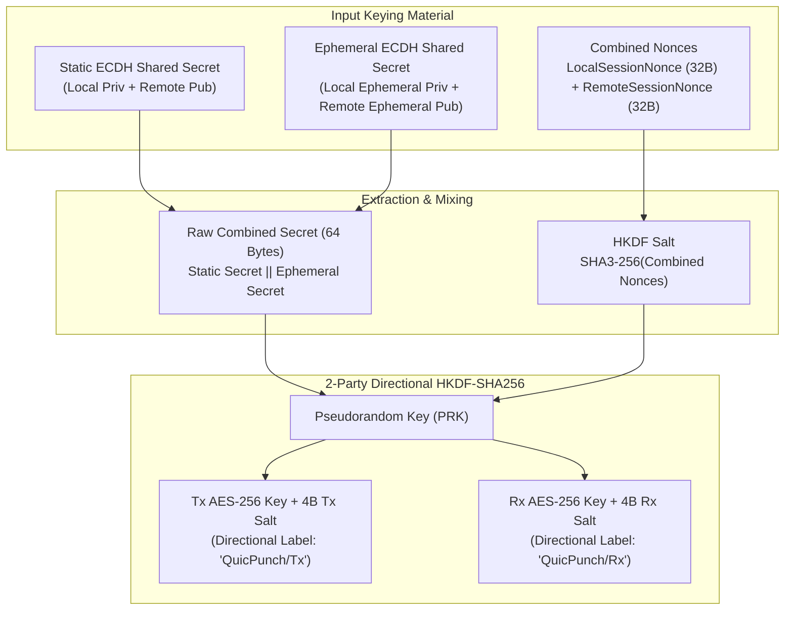

# Cryptography & Security Architecture

> QuicPunch uses state-of-the-art cryptographic primitives conforming to modern standards (.NET 11 cryptography, RFC 6479, RFC 5869, RFC 8032, and BIP-340).

---

### Cryptographic Primitives Matrix

| Component | Cryptographic Primitive | Implementation Details |
| :--- | :--- | :--- |
| **Node Identity** | ECDSA over NIST P-256 (`ECDsa.Create(ECCurve.NamedCurves.nistP256)`) | Self-signed X.509 v3 Certificate with 20-year validity |
| **Identity Fingerprint** | SHA3-256 (`Sha3Crypto.Hash256`) | 32-byte hash of `certificate.GetPublicKey()` |
| **Access Control** | Zero-Trust Admission & Ephemeral Sets (`IPeerAccessController`) | Dynamic `ExpectedPeerCertSet`, persistent `PeerStore`, application trust and per-protocol permissions |
| **Key Exchange (P2P Control Plane)** | Ephemeral ECDH over NIST P-256 (`ECDiffieHellman`) | Fresh ephemeral keypair generated per session entropy rotation |
| **Key Derivation** | 2-Party HKDF-SHA256 (`HKDF.DeriveKey`) | Combines static ECDH, ephemeral ECDH, local & remote 32-byte nonces |
| **Handshake Session State** | AES-GCM-256 (`AesGcm`, 16-byte tag) | Directional ciphers and salts remain part of `PeerInfo.IsSessionReady`; the former UDP application-data channel has been retired |
| **Application Transport Security** | Native QUIC TLS 1.3 or Tor transport | Data is carried by authenticated virtual sessions after application trust and permission checks |
| **Decentralized Signaling** | BIP-340 64-byte Schnorr Signatures | NBitcoin.Secp256k1 4.0.1; secret-key operations use the maintained implementation |
| **Onion Addressing** | Tor v3 Ed25519 (`ED25519-V3`) | Extended Edwards curve point multiplication to 56-char base32 `.onion` |
| **Password Authentication** | HMAC-SHA3-256 Challenge-Response | 24-byte cryptographically secure random nonces |

---

## Session Key Derivation Flow (Control Plane)



### Line-Level Code Implementation in [`PeerInfo.InitSession`](../../QuicPunch/Structures/PeerInfo.cs)
```csharp
byte[] staticSecret = localStaticEcdh.DeriveKeyMaterial(peerPublicKey);
byte[] ephemeralSecret = localEphemeralEcdh.DeriveKeyMaterial(remoteEphemeralPublicKey);
byte[] rawSecret = new byte[staticSecret.Length + ephemeralSecret.Length];
Buffer.BlockCopy(staticSecret, 0, rawSecret, 0, staticSecret.Length);
Buffer.BlockCopy(ephemeralSecret, 0, rawSecret, staticSecret.Length, ephemeralSecret.Length);

byte[] salt = SHA3_256.HashData(combinedNonces);
byte[] keyMaterial = HKDF.DeriveKey(HashAlgorithmName.SHA256, rawSecret, 64, salt, infoLabel);
```

---

## RFC 6479 Sliding Window Anti-Replay Engine

[`AntiReplayWindow`](../../QuicPunch/Helpers/AntiReplayWindow.cs) is a retained, independently tested 128-packet sliding-window utility. It previously protected the UDP application-data channel, which has been retired. Current WAN application traffic uses QUIC's transport protection; signed discovery/control packets keep their existing challenge, timestamp and session validation. The window below does not describe the current application receive pipeline.

### Data Structure & Bitfield Mechanics
- **Sequence Number Counter**: `ulong _lastSequence` tracks the highest validated sequence number received.
- **128-Bit Sliding Bitmap**: `UInt128 _window` represents the previous 128 sequence numbers.
- **Concurrency**: Uses bitwise arithmetic protected by a lock for multithreaded access.

```
       <-- Older packets (Dropped) | [128-bit Sliding Window] | Newer packets -->
  ... -----------------------------|--------------------------|-----------------
                                   ^                          ^
                      (_lastSequence - 128)             _lastSequence
```

### Verification Rules
1. **Sequence == 0**: Instantly rejected.
2. **Sequence > `_lastSequence`**:
   - If diff < 128: Shift bitmap left by `diff` bits, set bit 0 to `1`, update `_lastSequence = sequence`.
   - If diff >= 128: Reset bitmap to `1`, update `_lastSequence = sequence`.
3. **Sequence <= `_lastSequence`**:
   - Calculate `diff = _lastSequence - sequence`.
   - If `diff >= 128`: Packet is outside the window (too old) -> **Rejected**.
   - Check bit `(1 << diff)`:
     - If bit is `1`: Duplicate/replayed packet -> **Rejected**.
     - If bit is `0`: Valid out-of-order packet -> Set bit to `1` -> **Accepted**.

---

## Zero-Trust Admission & Peer Access Control

QuicPunch implements strict zero-trust access control via [`IPeerAccessController`](../../QuicPunch/Security/PeerAccessController.cs) and [`ExpectedPeerCertSet`](../../QuicPunch/Security/PeerAccessController.cs).

### Core Responsibilities
1. **Separation of Signaling & Admission**: Any node can announce itself on Nostr or ping via UDP, but no application session (Chat, Virtual LAN, Voice, QuicWatch) will activate unless authorized.
2. **In-Memory Expected Certificates**: `ExpectedPeerCertSet` stores SHA3-256 certificate hashes of explicitly invited peers (e.g. via pairing tokens or invite links).
3. **Persistent Peer Store Integration**: `IsTrusted(certHash)` validates against both active `ExpectedPeerCerts` and persistent disk entries in [`PeerStore`](../../QuicPunch/Helpers/PeerStore.cs).
4. **Automatic Authenticated Transport**: `PeerTransportOptions` prepares QUIC for discovered peers without granting trust. Certificate pinning and authenticated control routing remain mandatory. It bounds concurrent attempts and peer count, retries with backoff, and parks idle transports with a control notification to both endpoints.
5. **Application Boundary Guard**:
   ```csharp
   peerAccessController.EnsureAllowedForApplication(peer);
   ```
   Throws `InvalidOperationException` if an untrusted peer attempts to open application protocol streams. Trusted chat is automatic; other applications require their own permission or local approval. See [peer transport](../core/peer-transport.md).

---

## Public Key Fingerprinting & Certificate Pinning

QuicPunch rejects traditional CA hierarchy vulnerabilities by enforcing **cryptographic certificate pinning**:
1. At node initialization, [`CertManager`](../../QuicPunch/Helpers/CertManager.cs) generates a self-signed X.509 ECDSA cert with `ECCurve.NamedCurves.nistP256`.
2. The cert fingerprint is `SHA3_256.HashData(cert.GetPublicKey())`.
3. When establishing a native QUIC connection (`System.Net.Quic`), `RemoteCertificateValidationCallback` extracts the remote public key, computes the SHA3-256 hash, and compares it in **constant time** (`CryptographicOperations.FixedTimeEquals`) against the pinned `peerCertificate` hash.
