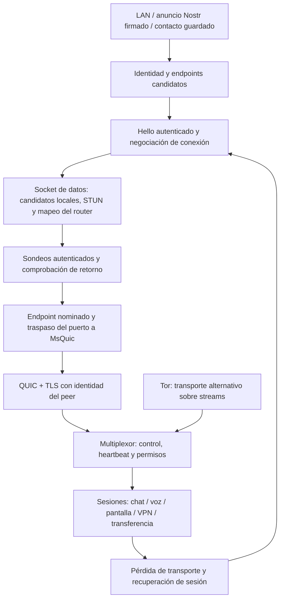

# Auditoría de conectividad P2P y QUIC — 6 de noviembre de 2026

> Actualización: se implementaron las correcciones posteriores a esta auditoría. El estado vigente, las pruebas y las limitaciones están en [Correcciones P2P/QUIC](p2p-quic-fixes-2026-11-06.md). El resto de este documento conserva el diagnóstico inicial. TURN queda excluido por decisión del producto.

El sistema tiene una base sólida de identidad, QUIC y sesiones recuperables, pero todavía no puede considerarse una implementación P2P de máxima robustez. Las mayores limitaciones son la cobertura de redes, la gestión de colas y la recuperación ante cambios de ruta. Aumentar ventanas, puertos de sondeo o prioridades no resuelve esos problemas.

Se revisaron descubrimiento LAN/Nostr, STUN, candidatos, apertura de puertos, perforación NAT, establecimiento QUIC, ajustes MsQuic, Android, Tor, multiplexación, recuperación, voz, vídeo y VPN. Se contrastó el código con documentación primaria y se ejecutaron pruebas locales. Esto no es una certificación de interoperabilidad ni una prueba entre todas las combinaciones de routers, operadores y dispositivos.

La revisión corresponde al árbol de trabajo, que contiene modificaciones previas y cambios concurrentes de otras tareas. No se ha publicado una versión ni reiniciado la aplicación en uso. Los binarios de comprobación están en bin/Test y obj/Test.

## Recorrido real de una conexión

El puerto de descubrimiento/control y el puerto de QUIC son distintos. El anuncio Nostr ayuda a encontrarlos; sus relays no transportan por ello los datagramas QUIC de voz o VPN. Un heartbeat demuestra que el otro extremo respondió; escribir correctamente en un stream no demuestra que siga vivo.

La perforación actual usa candidatos y pruebas propias. No implementa la máquina de estados completa de ICE. Hay controles útiles: prueba de retorno antes de nominar, sondeos limitados, limitación de peers/intentos y autorización independiente para abrir protocolos.

## Hallazgos que requieren trabajo

Prioridad P1: afecta a conectividad, recuperación, consumo de memoria o calidad de forma importante. P2: degradación, robustez o mantenimiento. «Confirmado por código» no significa que se haya reproducido en un teléfono o una WAN real.

### 1. P1 — Validación STUN incompleta: corregido y probado

Antes de la corrección, TryProcessIncoming ignoraba el endpoint de origen, retiraba la transacción antes de validar el contenido y no comprobaba su expiración al recibir. El parser podía aceptar atributos fuera de la longitud declarada o mensajes truncados, y aceptaba puerto cero. Además, GatherCandidatesAsync tenía otro camino de recepción que ni siquiera correlacionaba las respuestas con las transacciones enviadas.

Se corrigieron ambos caminos: origen IP/puerto, transacción pendiente y vigente, consumo único después de validar, límites de mensaje/atributos y puerto útil. La recogida de candidatos reutiliza ahora el cliente validado y espera la terminación de su tarea de reenvío. No se cambió el formato en la red.

La regresión inicial falló en 9 de 10 comprobaciones. Tras el arreglo pasan las 11 comprobaciones, incluida la respuesta con transacción falsa en el camino de candidatos.

Evidencia: [QuicPunch/Discovery/SimpleStunClient.cs](<C:/Users/Mrgaton/Syncthing/Programs/CSharp Test Programs/UdpPunchHoleTest/QuicPunch/Discovery/SimpleStunClient.cs:142>), [QuicPunchTests/Tests/StunValidationTests.cs](<C:/Users/Mrgaton/Syncthing/Programs/CSharp Test Programs/UdpPunchHoleTest/QuicPunchTests/Tests/StunValidationTests.cs:8>). La correlación y validación de respuestas corresponden al modelo de [STUN, RFC 8489](https://www.rfc-editor.org/rfc/rfc8489.html). No se afirma conformidad completa con todas sus extensiones ni protección frente a un servidor STUN malicioso.

### 2. P1 — Una llamada corrompía la ruta de control al migrar QUIC: corregido y probado

El callback de movilidad de VoiceCallHandler asignaba el nuevo endpoint QUIC a peer.ActiveEndPoint. Ese campo es la ruta de control; una reconexión podía enviar allí mensajes destinados al otro socket.

Ahora usa UpdateQuicEndPoint, igual que el transporte principal, y conserva la ruta de control. La nueva prueba abre un handler de llamada con transporte y audio simulados, emite el evento de migración y verifica ambos endpoints. Falló antes del cambio y pasa después. No utiliza micrófono ni llama a un contacto.

Evidencia: [QuicNet.Shared/Protocols/VoiceCallHandler.cs](<C:/Users/Mrgaton/Syncthing/Programs/CSharp Test Programs/UdpPunchHoleTest/QuicNet.Shared/Protocols/VoiceCallHandler.cs:534>), [QuicPunchTests/Tests/VoiceMobilityTests.cs](<C:/Users/Mrgaton/Syncthing/Programs/CSharp Test Programs/UdpPunchHoleTest/QuicPunchTests/Tests/VoiceMobilityTests.cs:10>).

### 3. P1 — Falta una salida automática cuando el enlace directo es imposible

CandidateType solo incluye Host, ServerReflexive y PeerReflexive. No hay implementación de asignaciones TURN, permisos y canales, ni candidato Relay para el transporte WAN. Tor existe como otro transporte, con identidades y política propias; no equivale a un relay UDP automático de baja latencia.

Esto deja combinaciones de CGNAT restrictivo, NAT simétrico y bloqueo de UDP sin una ruta WAN garantizada. Más STUN o más puertos no elimina esa limitación. Incorporar un relay requiere también infraestructura, autenticación, cuotas y adaptación del transporte; no es cambiar una constante.

Objetivo: establecer una ruta utilizable directa o retransmitida dentro del mismo presupuesto de conexión, mantener cifrado extremo a extremo y mejorar a directa cuando aparezca. [TURN](https://www.rfc-editor.org/rfc/rfc8656.html) aborda esos casos; [ICE](https://www.rfc-editor.org/rfc/rfc8445.html) organiza candidatos y comprobaciones. [libp2p DCUtR](https://raw.githubusercontent.com/libp2p/specs/master/relay/DCUtR.md) describe el ascenso de relay a conexión directa y [Circuit Relay v2](https://raw.githubusercontent.com/libp2p/specs/master/relay/circuit-v2.md) introduce reservas y límites de recursos. Son referencias de diseño, no capacidades ya presentes aquí.

Evidencia local: [QuicPunch/QuicPunchStructures.cs](<C:/Users/Mrgaton/Syncthing/Programs/CSharp Test Programs/UdpPunchHoleTest/QuicPunch/QuicPunchStructures.cs:31>), [QuicPunch/QuicPunchConnection.cs](<C:/Users/Mrgaton/Syncthing/Programs/CSharp Test Programs/UdpPunchHoleTest/QuicPunch/QuicPunchConnection.cs:24>).

### 4. P1 — IPv6 no está integrado de extremo a extremo

SimpleStunClient exige un socket IPv4. Utilities filtra endpoints/token a IPv4 y el protocolo de candidatos/Hello tiene supuestos de direcciones de cuatro bytes. Que MsQuic o PCP puedan manejar IPv6 no hace que el sistema completo lo soporte.

Impacto: se pierde conectividad directa disponible por IPv6 y se depende de traducción o de IPv4 en redes modernas. Añadir únicamente un socket dual-stack sería insuficiente.

Objetivo: versionar el formato de direcciones, conservar compatibilidad, recoger IPv4/IPv6 por interfaz, probar ambas familias con retraso corto y cancelar las alternativas al establecer una ruta válida. Probar IPv6-only/NAT64 y cambios entre familias.

Evidencia: [QuicPunch/Discovery/SimpleStunClient.cs](<C:/Users/Mrgaton/Syncthing/Programs/CSharp Test Programs/UdpPunchHoleTest/QuicPunch/Discovery/SimpleStunClient.cs:64>), [QuicPunch/Helpers/Utilities.cs](<C:/Users/Mrgaton/Syncthing/Programs/CSharp Test Programs/UdpPunchHoleTest/QuicPunch/Helpers/Utilities.cs:509>), [QuicPunch/PacketHandler/HelloHandler.cs](<C:/Users/Mrgaton/Syncthing/Programs/CSharp Test Programs/UdpPunchHoleTest/QuicPunch/PacketHandler/HelloHandler.cs>).

### 5. P1 — La primera sesión conserva una ventana de fallo sin recuperación

El arreglo de la llamada inicial comprueba liveness antes de OpenVirtualSessionAsync. Sin embargo, si la conexión cae después de esa comprobación, mientras se espera la respuesta de apertura, la variable connection sigue siendo null. El filtro de recuperación solo admite connection == null cuando recovering ya era true.

Resultado: puede seguir siendo necesario otro clic si la caída ocurre precisamente durante la apertura inicial. Es una carrera confirmada por la estructura del código; no se ha reproducido esta ventana concreta en la llamada original.

Objetivo: reintentar errores transitorios de transporte dentro del presupuesto inicial, con la misma identidad de solicitud y deduplicación; no reintentar una denegación ni un fallo de autorización. Probar corte antes de solicitar, después de aceptar remotamente y antes de recibir la aceptación local. La aceptación perdida exige especial cuidado para no duplicar sesiones.

Evidencia: [QuicPunch/QuicPunch.SessionRecovery.cs](<C:/Users/Mrgaton/Syncthing/Programs/CSharp Test Programs/UdpPunchHoleTest/QuicPunch/QuicPunch.SessionRecovery.cs:121>) y filtro de excepción en la línea 142.

### 6. P1 — Cola nativa de recepción de datagramas sin límite en Android

Cada DATAGRAM_RECEIVED reserva memoria y añade un nodo a una lista enlazada. No hay contador máximo de bytes/paquetes ni caducidad. Si el lector administrado se retrasa o se suspende, la cola puede crecer mientras el extremo remoto sigue enviando. La limitación de streams no limita esta lista.

Objetivo: presupuesto por conexión de bytes y paquetes, descarte de datos antiguos según clase, contadores de presión y pruebas con consumidor detenido. Separar el callback nativo del trabajo costoso. No se ha modificado ni compilado el C de Android en esta auditoría.

Evidencia: [QuicPunch.AndroidProbe/native/qp_transport.c](<C:/Users/Mrgaton/Syncthing/Programs/CSharp Test Programs/UdpPunchHoleTest/QuicPunch.AndroidProbe/native/qp_transport.c:276>) y lectura desde datagrams_head alrededor de la línea 651. QUIC DATAGRAM usa control de congestión, pero no flow control de recepción equivalente al de streams: [RFC 9221](https://www.rfc-editor.org/rfc/rfc9221.html).

### 7. P1 — La adaptación de bitrate de voz interpreta mal la salud reciente

UpdateAudioBitrate reduce 8 kbit/s cuando RTT > 120 ms aunque no haya pérdida. Solo aumenta si la pérdida es exactamente cero y RTT < 35 ms. El monitor entrega PacketLossRatio acumulado desde el inicio de la conexión.

Consecuencias demostrables por el código: un RTT estable de 150 ms lleva a reducir hasta el suelo aunque el enlace tenga capacidad; una pérdida histórica puede impedir que el cociente vuelva exactamente a cero, y una WAN sana de 50 ms tampoco cumple la condición de recuperación.

Objetivo: diferencias de contadores por intervalos, normalizar reinicios/cambios de transporte, estimar RTT mínimo y crecimiento de cola, recuperación gradual con histéresis y realimentación del receptor. Añadir pruebas de «pérdida al principio, luego recuperación», enlace intercontinental estable y peers con calidades diferentes.

Evidencia: [QuicNet.Shared/Protocols/VoiceCallHandler.cs](<C:/Users/Mrgaton/Syncthing/Programs/CSharp Test Programs/UdpPunchHoleTest/QuicNet.Shared/Protocols/VoiceCallHandler.cs:49>), monitor alrededor de la línea 569, [QuicPunch/Helpers/MsQuicTuner.cs](<C:/Users/Mrgaton/Syncthing/Programs/CSharp Test Programs/UdpPunchHoleTest/QuicPunch/Helpers/MsQuicTuner.cs:1960>). Pendiente de corrección; no se ha cambiado el algoritmo durante esta revisión.

### 8. P2 — La VPN mezcla entrega no fiable y fiable bajo presión

PeerLanSession intenta un datagrama del tamaño completo del paquete IP. Si no cabe en MaxSendDatagramLength, no hay canal disponible o Send devuelve false, el llamador lo encola en un stream fiable. La cola tiene límite de 512 paquetes.

Esto evita una pérdida inmediata, pero puede introducir bloqueo por retransmisiones y reordenamiento respecto a los siguientes paquetes que sí viajen como datagramas. TCP dentro de ese stream añade otra capa de retransmisión. El MTU de la interfaz, 1420 por defecto, no garantiza caber en todos los caminos, especialmente túneles y PMTU inicial.

Objetivo: relacionar el MTU con la capacidad efectiva del canal, definir una política explícita para paquetes demasiado grandes y congestión, y exponer el modo efectivo. No presentar siempre «Datagram» si se está usando el fallback fiable. No se recomienda aumentar el MTU a 9000 sin demostrar que el camino lo soporta.

Evidencia: [QuicNet/Protocols/VirtualLanHandler.cs](<C:/Users/Mrgaton/Syncthing/Programs/CSharp Test Programs/UdpPunchHoleTest/QuicNet/Protocols/VirtualLanHandler.cs:503>), [QuicNet/Protocols/VirtualLanHandler.cs](<C:/Users/Mrgaton/Syncthing/Programs/CSharp Test Programs/UdpPunchHoleTest/QuicNet/Protocols/VirtualLanHandler.cs:852>). No es un black hole silencioso por tamaño: existe el fallback descrito.

### 9. P2 — DSCP de voz se aplica a toda la conexión compartida

TrySetDscp del transporte virtual delega al transporte físico. Abrir una llamada marca ese QUIC como EF/46, por lo que también afecta a transferencias, speedtest y VPN que lo compartan. No se encontró restauración al acabar la llamada.

Objetivo: política de QoS del transporte con propiedad y restauración explícitas; si se necesita una clase IP distinta para voz, evaluar un transporte separado. La prioridad de un stream no convierte el resto del tráfico en paquetes de otra clase IP.

Evidencia: [QuicNet.Shared/Protocols/VoiceCallHandler.cs](<C:/Users/Mrgaton/Syncthing/Programs/CSharp Test Programs/UdpPunchHoleTest/QuicNet.Shared/Protocols/VoiceCallHandler.cs:495>), [QuicPunch/Multiplexer/MultiplexedQuicConnectionTransport.cs](<C:/Users/Mrgaton/Syncthing/Programs/CSharp Test Programs/UdpPunchHoleTest/QuicPunch/Multiplexer/MultiplexedQuicConnectionTransport.cs:124>). No se ha medido cómo trata EF el router del usuario.

### 10. P2 — Vídeo, audio de pantalla y control comparten el mismo stream

Los tipos de frame de pantalla usan SendFrameAsync y el mismo semáforo de escritura. Un frame grande en progreso precede a una orden de control o al audio de pantalla; además, la fiabilidad del stream conserva bytes que pueden haber perdido utilidad audiovisual. El receptor permite payloads de hasta 10 MiB.

Objetivo: canal de control independiente; transmisión de medios con unidades cancelables, presupuesto de edad y recuperación de decodificador. Streams separados evitan el bloqueo de orden entre esos streams, aunque siguen compartiendo congestión. Usar datagramas para vídeo requiere diseño de fragmentación, pérdidas y keyframes, no simplemente cambiar WriteAsync por Send.

SendFrameAsync también absorbe errores/cancelación de escritura. Debe revisarse que un envío parcial invalide el framing o cierre el stream antes de mandar otro frame; no se ha demostrado corrupción de framing en esta ejecución.

Evidencia: [QuicNet.Shared/Protocols/VoiceCallHandler.cs](<C:/Users/Mrgaton/Syncthing/Programs/CSharp Test Programs/UdpPunchHoleTest/QuicNet.Shared/Protocols/VoiceCallHandler.cs:199>). El reensamblador genérico sí tiene límites (32 frames, 2 MiB por frame, TTL 250 ms); no confundirlo con la ruta actual de pantalla por stream.

### 11. P2 — Los mapeadores pueden conservar el gateway de una red anterior

PCP y NAT-PMP guardan gateway/local IP en el constructor. NotifyNetworkChangedAsync limpia anuncios y muestras STUN, pero no recrea _controlMapping. Su renovación puede seguir intentando el gateway antiguo. Un mapper nuevo debe ligarse a la generación de red para impedir que un resultado tardío vuelva a anunciar una dirección vieja.

Objetivo: reconstruir leases al cambiar de ruta/interfaz y probar cambio entre dos gateways simulados, incluidos resultados tardíos. MapTunnelAsync también usa LifecycleToken al iniciar el lease tras adquirir la puerta; revisar cancelación del intento y limpieza de leases temporales.

Evidencia: [QuicPunch/QuicPunch.SessionRecovery.cs](<C:/Users/Mrgaton/Syncthing/Programs/CSharp Test Programs/UdpPunchHoleTest/QuicPunch/QuicPunch.SessionRecovery.cs:185>), [QuicPunch/QuicPunch.PortMappings.cs](<C:/Users/Mrgaton/Syncthing/Programs/CSharp Test Programs/UdpPunchHoleTest/QuicPunch/QuicPunch.PortMappings.cs:16>), [QuicPunch/Discovery/PortMapping/PcpPortMapper.cs](<C:/Users/Mrgaton/Syncthing/Programs/CSharp Test Programs/UdpPunchHoleTest/QuicPunch/Discovery/PortMapping/PcpPortMapper.cs:34>), [QuicPunch/Discovery/PortMapping/NatPmpPortMapper.cs](<C:/Users/Mrgaton/Syncthing/Programs/CSharp Test Programs/UdpPunchHoleTest/QuicPunch/Discovery/PortMapping/NatPmpPortMapper.cs:25>). Confirmado por código; falta reproducción con cambio real de router.

### 12. P2 — Frecuencia de descubrimiento y liveness poco adaptativa

NatPinCoordinator usa lotes de hasta 32 servidores, espera 700 ms y vuelve a esperar 1500 ms antes del siguiente ciclo. Con respuestas suficientes y catálogo completo equivale aproximadamente a 14,5 solicitudes/s de sondeo continuo, aparte de los intentos de conexión. Es útil al caracterizar NAT, pero excesivo como política permanente para muchas redes estables o móviles.

Además hay heartbeat de aplicación cada 2 s, timeout fijo de 8 s y keepalive QUIC de 5 s en escritorio, frente a 19 s en Android. Son mecanismos distintos pero con trabajo parcialmente redundante. Una suspensión del proceso o una cola Tor puede parecer pérdida de conexión.

Objetivo: fase rápida al conectar/cambiar de red, reducir sondeos en estabilidad, jitter en reintentos y perfiles de liveness por transporte/actividad. Mantener una prueba de retorno autenticada, sin equiparar tráfico saliente con liveness.

Evidencia: [QuicPunch/Discovery/NatPinCoordinator.cs](<C:/Users/Mrgaton/Syncthing/Programs/CSharp Test Programs/UdpPunchHoleTest/QuicPunch/Discovery/NatPinCoordinator.cs:16>), [QuicPunch/PeerTransportOptions.cs](<C:/Users/Mrgaton/Syncthing/Programs/CSharp Test Programs/UdpPunchHoleTest/QuicPunch/PeerTransportOptions.cs:5>), [QuicPunch.AndroidProbe/native/qp_transport.c](<C:/Users/Mrgaton/Syncthing/Programs/CSharp Test Programs/UdpPunchHoleTest/QuicPunch.AndroidProbe/native/qp_transport.c:368>).

### 13. P2 — Las colas de envío no expresan la caducidad del tráfico

MsQuicDatagramChannel reserva una copia nativa por envío pendiente y no impone presupuesto propio de bytes/edad. Todos los datagramas usan prioridad de datagrama. Conviene medir presión y limitar por clase; la API nativa contempla cancelación si el envío queda bloqueado, cuya compatibilidad debe comprobarse en la biblioteca fijada antes de usarla. Véase [DatagramSend](https://raw.githubusercontent.com/microsoft/msquic/main/docs/api/DatagramSend.md).

TorEmulatedDatagramChannel tiene 1024 posiciones y, al llenarse, conserva lo antiguo y rechaza nuevos envíos mediante TryWrite. A 50 paquetes/s, 1024 posiciones representan unos 20,5 s de audio si se llena la cola. El transporte Tor sigue siendo fiable y ordenado; la interfaz llamada «datagram» no elimina ese comportamiento.

Objetivo: colas con edad máxima, DropOldest donde el protocolo lo permita y métricas de descarte. No aplicar la misma política a voz, control y paquetes VPN.

Evidencia: [QuicPunch/Helpers/MsQuicDatagramChannel.cs](<C:/Users/Mrgaton/Syncthing/Programs/CSharp Test Programs/UdpPunchHoleTest/QuicPunch/Helpers/MsQuicDatagramChannel.cs:549>), [QuicPunch/Tor/TorEmulatedDatagramChannel.cs](<C:/Users/Mrgaton/Syncthing/Programs/CSharp Test Programs/UdpPunchHoleTest/QuicPunch/Tor/TorEmulatedDatagramChannel.cs:21>). Se identificó el riesgo de acumulación; no se ha realizado una prueba de agotamiento de memoria.

### 14. P2 — La configuración «óptima» es global y depende de detalles privados

MsQuicTuner accede a campos privados de System.Net.Quic y escribe una estructura nativa por offsets. Hay un commit nativo fijado y pruebas de lectura efectiva, lo cual ayuda, pero una actualización del runtime/ABI puede romper esa integración.

También se parchea la caché global de configuraciones. TryApplyOptimalConfiguration vuelve a crear los valores predeterminados, por lo que opciones específicas pueden perderse o afectar a otros perfiles. Los límites de streams y keepalive efectivos difieren de los que aparentan indicar las opciones administradas.

Objetivo: una política explícita y versionada por plataforma/perfil, validación de ABI al arrancar, telemetría de configuración efectiva y reducción de hooks privados cuando exista API soportada. Fijar «requested» en una bandera no demuestra que se use la aceleración.

Evidencia: [QuicPunch/Helpers/MsQuicTuner.cs](<C:/Users/Mrgaton/Syncthing/Programs/CSharp Test Programs/UdpPunchHoleTest/QuicPunch/Helpers/MsQuicTuner.cs:80>), [QuicPunch/Helpers/MsQuicTuner.cs](<C:/Users/Mrgaton/Syncthing/Programs/CSharp Test Programs/UdpPunchHoleTest/QuicPunch/Helpers/MsQuicTuner.cs:954>), [QuicPunch.NativeBuilder/native-build.lock.json](<C:/Users/Mrgaton/Syncthing/Programs/CSharp Test Programs/UdpPunchHoleTest/QuicPunch.NativeBuilder/native-build.lock.json>).

## Configuración actual y criterio recomendado

La documentación de [MsQuic Settings](https://raw.githubusercontent.com/microsoft/msquic/main/docs/Settings.md) recomienda justificar los cambios mediante pruebas A/B. La siguiente tabla es una política propuesta, no una afirmación de que todos esos cambios estén aplicados.

| Área | Estado observado | Decisión recomendada |
|---|---|---|
| Congestión | BBR, valor nativo 1; CUBIC 0 disponible | Conservar BBR como base mientras se amplía la matriz; no confundir «BBR» con BBRv3 |
| Pacing | Activado | Mantener y medir latencia bajo carga |
| Ventanas | 16 MiB conexión, 4 MiB stream; buffer inicial de stream también 4 MiB | Dimensionar por BDP y presupuesto de memoria; separar buffer inicial y ventana; medir 1/8/32/64 peers |
| Streams | Escritorio parcheado a 2048 bidi + 2048 unidi; opciones administradas y Android 512 | Reducir al número concurrente realmente necesario; medir antes de elegir una cifra |
| MTU | Mínimo 1280, máximo 1500; VPN 1420 | Evaluar mínimo nativo conservador 1248; PMTU y payload efectivo por camino; nada de jumbo global |
| Inicio | IW10, RTT inicial 100 ms, ACK delay 10 ms | Base razonable; no elevar IW ni forzar ACK inmediato indiscriminadamente |
| ECN | Solicitado en escritorio | Verificar validación/feedback y reacción real del algoritmo; no prometer L4S |
| Migración | Activada | Mantener, probar rebinding y cambios de interfaz; no equivale a multipath simultáneo |
| TLS | MsQuic/OpenSSL local, grupos X25519MLKEM768:X25519 | Mantener pinning de identidad; mostrar grupo negociado. El fallback clásico implica que no toda conexión será PQC |
| Reanudación | Se activa capacidad servidor 0-RTT; hay helpers/ticket fields | No afirmar 0-RTT efectivo: no se encontró ciclo completo de tickets en el flujo normal. Definir antirreplay/idempotencia antes de usar datos tempranos |
| XDP | Solicitado por defecto en Windows, fallback sockets | A/B con QUICNET_XDP=0, medir CPU/p99 y ruta efectiva; requested no demuestra datapath activo |
| Liveness | Heartbeat 2 s/8 s; keepalive nativo escritorio 5 s | Unificar política y adaptar a estado/transporte; no subir timeouts para ocultar fallos |

Los valores nativos y el significado de reanudación/MTU se contrastaron con [QUIC_SETTINGS del commit fijado](https://raw.githubusercontent.com/microsoft/msquic/80a065112426bce68c1da42d026478d3e40fd45e/docs/api/QUIC_SETTINGS.md). Habilitar reanudación en servidor exige además emitir tickets. La migración de QUIC está descrita en [RFC 9000](https://www.rfc-editor.org/rfc/rfc9000.html); no debe interpretarse como agregación de ancho de banda entre interfaces.

Para ventanas: BDP = bits/s × RTT / 8. Por ejemplo, 1 Gbit/s a 80 ms son unos 10 MB; 10 Gbit/s a 80 ms, unos 100 MB. Es una referencia de volumen en vuelo, no una orden de reservar ese buffer en cada stream. La ventana de conexión, las ventanas de stream y el control de congestión son límites diferentes.

ALPN/SNI también merecen revisión: se anuncia h3 y un nombre de disfraz, pero el protocolo de aplicación propio no implementa HTTP/3. No asumir que eso proporciona interoperabilidad HTTP/3 ni invisibilidad ante filtros. Versionar un ALPN propio sería una decisión de protocolo, con transición coordinada entre versiones.

## Desde la capa física hasta la aplicación

| Capa | Qué se observó | Qué falta medir o cambiar |
|---|---|---|
| Física y enlace | Ethernet Mellanox activo a 10 Gbit/s; Wi-Fi desconectado | La velocidad negociada no mide Internet ni latencia; perfilar RSS/offloads/CPU con carga real antes de tocar drivers |
| Contadores del host | Ethernet: 55 143 descartes de recepción acumulados, sin errores de paquete reportados. WireGuard: errores salientes pasaron de 33 973 a 33 981 entre dos lecturas | Investigar deltas con destino/interfaz identificados; estos contadores no prueban la causa del fallo de llamada ni un cable defectuoso |
| IP y rutas | Ethernet MTU 1500; WireGuard 1420, métrica 5; VirtualBox 1404; interfaces Hyper-V adicionales | Registrar interfaz/ruta seleccionada por conexión; la métrica sola no decide sin considerar el prefijo de destino. Probar multihoming y túneles |
| NAT y firewall | STUN + PCP/NAT-PMP/UPnP + perforación | IPv6, relay, selección de candidatos, migración de gateway y presupuesto de sondeo |
| UDP y QUIC | Datagramas, streams, TLS, pacing, BBR, PMTU, migración | Colas acotadas por edad/bytes; validar configuraciones por plataforma |
| Sesiones y seguridad | Identidad fijada, pruebas de retorno, antirreplay, permisos y heartbeat correlacionado | Recuperar apertura inicial ambigua y probar fallos en cada transición |
| Aplicación | Voz por datagramas; pantalla por stream; VPN con fallback fiable | Adaptación por métricas recientes, separar control/medios y reflejar el transporte efectivo en UI |

No se modificaron rutas, MTU del sistema, firewall, drivers ni ajustes del router. No se ha observado el enlace físico del otro equipo, su NAT ni una transición real Wi-Fi→móvil.

La base de seguridad no se ha dado por ausente: se verificaron rutas de firma, pinning del certificado, derivación de claves, permisos de sesión y límites. El intercambio TLS híbrido pasó una prueba nativa. Eso no convierte en poscuánticas las firmas de identidad ni toda la señalización.

## Mediciones ejecutadas

Comparación secuencial en loopback con proxy de retardo de 40 ms por sentido y descarte determinista de 1 de cada 500 paquetes. Ambos casos usan multiplexor y ventanas preparadas. Se leyó cc=1/0 del nativo para confirmar la variable comparada.

| Algoritmo | Subida | Bajada | RTT base medido | RTT con carga |
|---|---:|---:|---:|---:|
| BBR | 530,32 Mbit/s | 488,16 Mbit/s | 91,94 ms | 98,40 ms |
| CUBIC | 6,66 Mbit/s | 6,13 Mbit/s | 92,81 ms | 102,33 ms |

BBR funcionó claramente mejor en ese escenario de pérdida artificial. Es una muestra por caso, con colas no acotadas en el proxy y sin limitador de ancho de banda, AQM ni competidores. No mide capacidad de la tarjeta, equidad, consumo móvil, p95/p99 o rendimiento entre dos ISP. No justifica declarar BBR universalmente óptimo ni actualizar a una variante experimental solo por su nombre.

Fixture: [QuicPunchTests/Tests/QuicPerformanceTests.cs](<C:/Users/Mrgaton/Syncthing/Programs/CSharp Test Programs/UdpPunchHoleTest/QuicPunchTests/Tests/QuicPerformanceTests.cs:20>). Logs regenerables: [.artifacts/p2p-audit-bbr.log](<C:/Users/Mrgaton/Syncthing/Programs/CSharp Test Programs/UdpPunchHoleTest/.artifacts/p2p-audit-bbr.log>) y [.artifacts/p2p-audit-cubic.log](<C:/Users/Mrgaton/Syncthing/Programs/CSharp Test Programs/UdpPunchHoleTest/.artifacts/p2p-audit-cubic.log>).

Verificación funcional de esta auditoría:

- Compilación de QuicPunchTests en configuración Test: correcta. La última compilación registrada tuvo 0 errores y 0 warnings; usa .NET 11 RC.
- Correctas: --test-stun-validation, --test-voice-mobility, --test-connectivity-security, --test-quic-optimizations, --test-quic-datagrams, --test-session-recovery, --test-antireplay, --test-pqc, --test-handshake-cancellation, --test-connection-recovery, --test-multiplexer, --test-automatic-transport --loopback-only, --test-vpn-policy y --test-port-openers.
- --test-security NO terminó en verde: TestNostrSpoofingRejectedForSavedPeer esperaba puerto 50005 y observó 53702. No falló la comprobación de aceptación de un token falsificado; falló la actualización legítima posterior.
- Esa suite inicia nodos WAN y cambia manualmente CurrentPeer.PortArray mientras siguen activos descubrimiento y STUN. El log contiene actividad LAN/WAN ajena al escenario. Hay indicios de contaminación/carrera del fixture, pero no se ha aislado la causa de este fallo. No se considera certificado el conjunto completo de seguridad.
- Las pruebas de nuevas correcciones sí son deterministas y locales. No se ejecutó una matriz Android/Linux/iOS ni redes reales de operadores.

Log del fallo amplio: [.artifacts/test-output/test-security-20261106-202810-4d4d3f8566974e6a92432fb09055cbf0.log](<C:/Users/Mrgaton/Syncthing/Programs/CSharp Test Programs/UdpPunchHoleTest/.artifacts/test-output/test-security-20261106-202810-4d4d3f8566974e6a92432fb09055cbf0.log>). Test implicado: [QuicPunchTests/Tests/SecurityDiscoveryTests.cs](<C:/Users/Mrgaton/Syncthing/Programs/CSharp Test Programs/UdpPunchHoleTest/QuicPunchTests/Tests/SecurityDiscoveryTests.cs:3557>). Prioridad de validación: aislar todas las suites de descubrimiento de peers reales y reproducir esta actualización con STUN/relay simulados.

## Plan para alcanzar una base P2P de referencia

1. Completar corrección de apertura inicial, límites Android, bitrate reciente y renovación por generación de red. Mantener las dos regresiones añadidas en CI. Aislar el fallo de Nostr antes de dar por verde la suite de seguridad.
2. Diseñar una capa de rutas con candidatos IPv4/IPv6, relay autenticado, cancelación de alternativas y transición a directo. Preservar identidad y permisos al cambiar de camino. Como referencia operativa, [Tailscale combina rutas directas y relays que retransmiten tráfico ya cifrado](https://tailscale.com/docs/reference/derp-servers); el cifrado extremo a extremo no obliga a que cada paquete viaje directamente.
3. Establecer perfiles de tráfico: control con plazo corto; voz con descarte por edad; vídeo con cancelación de unidades obsoletas; transferencia fiable; VPN con política MTU y de congestión explícita. Presupuestos por peer y globales.
4. Hacer pruebas repetibles con ancho de banda limitado y colas controladas: RTT 5/40/80/150/300 ms; pérdida aleatoria y en ráfagas; reordenamiento; MTU bajo; NAT endpoint-dependent; UDP bloqueado; roaming, suspensión y 1/8/32/64 peers. No ejecutar todas las combinaciones sin priorizar riesgos.
5. Medir tasa de éxito al primer intento, tiempos de establecimiento/recuperación p50/p95/p99, proporción directa/relay, goodput, latencia bajo carga, edad de voz/vídeo al reproducir, descartes por causa, memoria y CPU. Comparar BBR/CUBIC, XDP y tamaños de ventana con idénticos escenarios.
6. Definir objetivos de producto y aprobar cambios por resultados. Un objetivo propuesto para medios es acotar colas en decenas de milisegundos, con techo de edad alrededor de 100–250 ms según clase; debe validarse con el jitter buffer y el códec, no imponerse a control o transferencia.

Queda completada la revisión del recorrido principal y documentadas las limitaciones. Las dos correcciones acotadas están implementadas y probadas. El resto es trabajo identificado y priorizado, no funcionalidades ya implementadas ni una garantía de conectividad en todas las redes.

