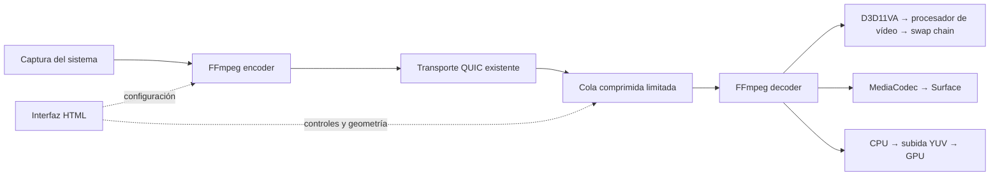

# NetTT: vídeo nativo con FFmpeg

Actualizado el 7 de noviembre de 2026. Esta arquitectura sustituye la propuesta inicial de recepción web.

## Motor y límites

FFmpeg n8.1.3 es el único decodificador de vídeo de las llamadas en Windows y Android. La interfaz HTML controla la llamada, muestra capacidades y comunica geometría; no recibe paquetes de vídeo ni píxeles decodificados. El archivo del decodificador web y la entrada de vídeo del WebSocket se han retirado.

Windows captura pantalla/cámara con FFmpeg CLI y recibe mediante las bibliotecas FFmpeg incluidas en la aplicación. La captura de Windows sigue requiriendo una instalación de FFmpeg; recibir vídeo no la requiere. Android incluye FFmpeg y captura mediante MediaProjection o Camera2 hacia la superficie de entrada del codificador FFmpeg/MediaCodec. La solicitud de permiso del sistema se conserva.

H.264, HEVC, VP9 y AV1 tienen decodificación por software. La aceleración depende del dispositivo y del perfil. Windows usa D3D11VA; Android selecciona explícitamente un componente MediaCodec anunciado como hardware y comprueba sus fotogramas. Android ofrece codificación H.264, HEVC y AV1 cuando el sistema anuncia el componente. No se anuncia un codificador VP9 Android inexistente.

La voz Opus y el audio de pantalla mantienen sus motores existentes. Esta migración cambia el vídeo de llamadas; no cambia el reproductor de archivos de Watch.

## Recorrido de los datos

En Windows, los fotogramas acelerados se mantienen en texturas D3D11. El procesador de vídeo convierte y escala en GPU. El swap chain limita la latencia de presentación a un fotograma; un compositor ocupado provoca descarte, sin cola ilimitada de presentaciones. El modo software convierte a NV12 y sube el resultado a GPU. Android presenta buffers MediaCodec directamente en Surface; su alternativa software sube planos YUV y realiza la conversión de color con GLES.

No se promete cero copias universal: conversión, composición y decodificación software tienen costes. El contador de presentación mide envíos a la superficie, no la llegada física de luz al panel. La duración de procesado no representa latencia de extremo a extremo.

## Capacidades antes de compartir

El mensaje de llamada `0x2B` intercambia un documento acotado de capacidades. Conserva las máscaras anteriores para compatibilidad de protocolo. Cada códec incluye estado, prueba de hardware/software, dimensiones ensayadas, componente y explicación.

- **Hardware verificado:** una muestra real produce fotogramas en el formato hardware esperado.
- **Software verificado:** FFmpeg produce fotogramas con el decodificador software.
- **No compatible:** ninguna ruta ensayada produce fotogramas.
- **Pendiente:** falta el motor, una prueba o el anuncio del participante.

Las muestras de arranque son sintéticas, 640×360, ocho fotogramas. No certifican todos los perfiles, profundidad de color, resoluciones o FPS. El inventario se prepara una vez al disponer de la superficie nativa y se reutiliza al entrar en llamada. Las peticiones remotas leen ese inventario sin abrir decodificadores ni superficies. Las detecciones simultáneas comparten la misma tarea; solo una actualización explícita repite las pruebas. El perfil final y la reproducción efectiva se validan con los primeros fotogramas. No se confunde apertura con rendimiento garantizado. Las capacidades remotas son anuncios del peer, no una certificación independiente.

## Latencia y recursos

Un hilo por flujo posee el decodificador, el contexto de presentación y su cierre. Esto evita que los contextos EGL migren entre continuaciones asíncronas. Las superficies se crean y mueven en el hilo de interfaz.

La recepción permite 0–250 ms de buffer y 2–32 unidades comprimidas pendientes, con un límite adicional de 16 MiB y 2 MiB por unidad. El perfil de juego usa 0 ms y cuatro unidades. El perfil de película propone 80 ms y 16 unidades; programa los fotogramas por su PTS respecto a un origen local y limita las discontinuidades del reloj remoto. Este buffer de vídeo no constituye todavía sincronización audiovisual completa.

Al saturarse la cola, se descartan las unidades pendientes y se espera una imagen clave. No se descarta una referencia comprimida para seguir decodificando sus dependencias como si siguieran siendo válidas. Una unidad con retraso excesivo también exige una imagen clave. Los fotogramas ya decodificados intermedios pueden descartarse con seguridad al presentar el más reciente.

Al ocultar un vídeo se dejan de aceptar paquetes, se libera el decodificador y se espera una nueva imagen clave al volver. Los cambios de geometría se agrupan y se envían en orden. Los diálogos ocultan las superficies nativas para conservar accesibles los controles.

El selector de recepción ofrece automático, solo hardware y solo software. Automático puede recuperarse por software ante un fallo hardware; «solo hardware» informa del error. El códec de salida seleccionado no cambia silenciosamente por la incompatibilidad de un receptor.

## Interfaz implementada

El estudio de llamadas muestra la matriz por participante, configuración de envío, presets del codificador, resolución, FPS, bitrate, CBR/VBR, intervalo de imágenes clave, buffer de bitrate y ajustes independientes de recepción. Android desactiva presets/CRF que su adaptador no aplica. Los valores de FPS son objetivos configurados, no un benchmark.

La matriz vive únicamente en los ajustes de vídeo y usa Hardware ★, Software ✓, No compatible × y Pendiente ·. Cada resultado conserva el detalle de GPU y CPU en su descripción. El selector muestra cuatro formatos con botones GPU/CPU fijos: pasar el ratón no abre contenido ni desplaza controles. Los presets y su resumen de valores están dentro de «Afinar la codificación»; no existe selector del antiguo motor de captura. La matriz identifica cada códec también en la disposición móvil. Los errores del motor aparecen en la cabecera del vídeo, fuera de la superficie nativa. La cabecera reserva su espacio también en pantalla completa y mantiene los controles accesibles aunque la superficie no reenvíe movimientos del puntero. El prototipo `index.html` conserva escenarios simulados para explorar el diseño; no representa capacidades medidas ni controla el motor.

## Código y distribución

- `native/media/nettt_media.cpp`: ABI, decodificación y presentación.
- `QuicNet.Shared/Video/NativeVideoRuntime.cs`: pruebas, política, colas y ciclo de vida.
- `VoiceCallHandler.NativeVideo.cs`: anuncio y negociación.
- `WindowsVideoHost.cs` / `AndroidVideoHost.cs`: superficies del sistema.
- `AndroidScreenCapture.cs`: permisos, MediaProjection/Camera2 y codificación FFmpeg.
- `wwwroot/native-video.js`: controles, geometría y estados, sin plano de vídeo.
- `scripts/build-native-media.sh`: compilación reproducible; commits fijados de FFmpeg y dav1d.

Las bibliotecas de Windows se incluyen en el ejecutable AOT. La prueba aislada del release debe decodificar las cuatro muestras sin DLL del árbol de desarrollo. Android empaqueta las cuatro bibliotecas ARM64. La publicación incluye fuentes, parche, instrucciones de reconstrucción y licencias en `native-media-source.tar.gz`.

## Validación

`python native/media/test_decoder.py --render` comprueba decodificación y presentación D3D11 con muestras reales. `--test-native-video` del ejecutable de pruebas comprueba códecs, planificación por PTS, política software, ocultación, parada y entradas inválidas. Los tests de navegador comprueban controles y ciclo de vida con APIs simuladas; no se presentan como pruebas de GPU.

La actividad Android `org.quicnet.NativeVideoTestActivity` existe únicamente en Debug y utiliza imágenes sintéticas. Su ejecución en hardware requiere un dispositivo que el usuario haya autorizado expresamente para pruebas. No utilizar las Quest del usuario.

Fuentes técnicas: [FFmpeg D3D11VA](https://github.com/FFmpeg/FFmpeg/blob/n8.1.3/libavutil/hwcontext_d3d11va.h), [FFmpeg MediaCodec](https://github.com/FFmpeg/FFmpeg/blob/n8.1.3/libavcodec/mediacodecenc.c), [Android SurfaceView](https://developer.android.com/reference/android/view/SurfaceView).
