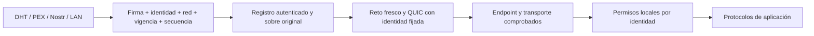

# Revisión y diseño de descubrimiento DHT autenticado

Fecha: 11 de octubre de 2026. Alcance: revisión del código actual y propuesta de implementación; este documento no introduce una DHT ejecutable.

## Resultado de la revisión

El proyecto descubre peers mediante Nostr, multicast LAN e intercambio de peers en ACK. No se ha encontrado un motor Kademlia: faltan tabla de routing por distancia XOR, bootstrap DHT, búsquedas iterativas y almacenamiento replicado. Una red de relays Nostr no es una DHT.

La base criptográfica permite construirlo: identidad persistente ECDSA P-256, huella SHA3-256 de la clave pública, firma del token, HELLO firmado y pinning del certificado en QUIC. Sin embargo, autenticidad de un anuncio, vigencia del anuncio, disponibilidad del endpoint y permisos del peer deben verificarse por separado.

## Lo que existe y sus límites

| Componente | Evidencia en el código | Resultado |
| --- | --- | --- |
| Token compacto | `Utilities.EncodeEndpointToken`, línea 464 | Incluye direcciones, puertos, flags y huella; no incluye firma, secuencia ni expiración. |
| Firma del token | `Utilities.SignToken`, línea 861; `TryVerifyTokenCertificate`, línea 907 | ECDSA/SHA-256 sobre el texto del token; comprueba que la clave pública corresponde a su huella. |
| Anuncio Nostr | `PeerDiscoveryManager.GetWanNostrDiscoveryPayload`, línea 621 | Envuelve el token con clave pública, firma y nombre. La firma del certificado cubre el token, no el nombre ni la clave del autor Nostr. |
| Validación del relay | `NostrDiscovery.ProcessRelayMessage`, línea 335 | Comprueba ID, firma Schnorr, canal y edad del evento; deduplica IDs de eventos. |
| Actualización de endpoints | `PeerDiscoveryManager.ProcessNostrEndpointTokenCore`, línea 795 | Rechaza firmas inválidas y anuncios sin firma para peers de confianza; no compara versiones del anuncio firmado. |
| Intercambio ACK | `PacketBuilder.GenerateAck`, línea 37; `AckHandler.HandleAck`, línea 17 | Firma la lista con la clave del intermediario. Cada entrada lleva endpoints y huella, sin sobre firmado por el peer anunciado. |
| Autenticación del transporte | `QuicPunchConnection.ValidateRemotePeerCertificate`, línea 777 | Compara la huella de la clave del certificado recibido con la identidad esperada. |

Las líneas son referencias a la copia de trabajo revisada.

### Hallazgos de seguridad

1. **No hay protección contra retroceso del anuncio firmado.** Un token antiguo sigue teniendo una firma ECDSA válida. Un actor que lo haya observado puede incluirlo en un evento Nostr nuevo firmado con su propia clave. La edad del evento externo no demuestra la edad del token interno. El receptor actualiza PeerStore antes incluso de aplicar el cooldown de candidatos. Esto puede restaurar endpoints antiguos; no permite falsificar la clave privada ni superar el pinning QUIC.

2. **El doble callback Nostr permite perder la comprobación del autor.** El coordinador se suscribe a `OnEventDiscovered` y `OnTokenFound` (líneas 422–423 para WAN, equivalente para Tor). El relay dispara ambos para el mismo evento (líneas 390–391). El segundo pasa por `OnWanNostrTokenDiscovered`, que sustituye el autor por una cadena vacía. La comprobación contra `savedPeer.NostrPubKey` sólo se ejecuta si ambas claves son no vacías. Por tanto, un anuncio con firma válida del certificado, rechazado por autor Nostr distinto en la primera entrega, puede procesarse en la segunda. La firma del certificado sigue siendo obligatoria para modificar peers de confianza. Usar una única entrega con todo el contexto validado.

3. **La firma del intermediario no acredita el anuncio de otro peer.** El ACK autentica quién envía la lista, no quién autorizó cada endpoint. Es admisible como fuente de candidatos no confiables, como hace actualmente el código; para replicar registros autenticados debe conservar el sobre original de cada peer.

4. **Se aceptan candidatos sin firma para identidades no confiables.** No reciben permisos automáticamente, pero pueden contaminar la lista de descubrimiento y originar sondas si está habilitada la conexión automática. En el nuevo camino DHT, los anuncios utilizables deben exigir firma desde la admisión.

5. **La representación de identidad debe documentarse sin ambigüedad.** El código usa `SHA3-256(cert.GetPublicKey())`, no el hash del certificado DER ni el hash de SPKI completo. La documentación actual menciona SPKI en una tabla, pero describe correctamente `GetPublicKey()` después. Cambiar a SPKI sin migración cambiaría todas las identidades y pines.

Los hallazgos 1–4 proceden de revisión estática; no se ha ejecutado una reproducción de explotación.

## Referencias y elección de protocolo

WebTorrent en Node utiliza `bittorrent-dht`; su configuración para navegador desactiva ese módulo. En navegador utiliza señalización de trackers compatible con WebRTC. Véanse el [código de WebTorrent](https://github.com/webtorrent/webtorrent/blob/master/package.json) y su [FAQ](https://webtorrent.io/faq).

La [DHT BitTorrent BEP 5](https://www.bittorrent.org/beps/bep_0005.html) devuelve endpoints. Su `token` es un permiso temporal de escritura ligado a la IP observada; no es una firma de identidad ni el token de conexión de QuicPunch. [BEP 44](https://www.bittorrent.org/beps/bep_0044.html) añade valores mutables firmados con Ed25519 y secuencia, con un límite de valor de aproximadamente 1000 bytes. Su formato no admite sustituir Ed25519 por ECDSA P-256 sin romper compatibilidad.

La [especificación Kademlia de libp2p](https://github.com/libp2p/specs/blob/master/kad-dht/README.md) distingue routing de peers, valores y providers. Los validadores de valores deben aplicarse al almacenar y recuperar. No debe asumirse que cualquier respuesta de provider incluye un anuncio firmado por su propietario. Los [sobres firmados](https://github.com/libp2p/specs/blob/master/RFC/0002-signed-envelopes.md) y [registros de routing](https://github.com/libp2p/specs/blob/master/RFC/0003-routing-records.md) proporcionan el patrón relevante para preservar autoría y secuencia.

**Propuesta para este proyecto:** una DHT propia Kademlia sobre el transporte QUIC existente, con registros firmados de QuicPunch. Es una propuesta inspirada en libp2p, no una implementación interoperable con libp2p o BitTorrent. Si se necesita interoperabilidad, elegir primero una pila libp2p y usar exactamente sus Peer IDs, protocolos y formatos; no anunciar el protocolo de libp2p para mensajes propios.

## Registro firmado propuesto

Crear `SignedPeerRecord` versionado, independiente del canal que lo transporte:

```text
version, networkId, scope, peerId,
publicKeyEncoding, publicKey,
sequence, issuedAt, expiresAt,
endpointToken, metadata, nostrPublicKey?,
signatureAlgorithm, signature
```

- `peerId`: huella completa de 32 bytes; conservar la representación actual para v1. Los IDs abreviados de interfaz no sirven como claves de seguridad o de routing.
- `publicKey`: punto público P-256 sin comprimir, con formato y curva fijos para v1. La huella debe coincidir con la del token y con la identidad objetivo.
- `scope`: WAN, LAN o Tor. No compartir identidad, endpoints o clave Nostr entre WAN y Tor por defecto.
- `sequence`: contador monotónico persistente por identidad/red/scope. Incrementarlo antes de emitir una versión nueva; renovaciones también generan versión nueva. Un reinicio no debe retrocederlo.
- `issuedAt` y `expiresAt`: forman parte de la firma. Aplicar límites de duración y tolerancia de reloj explícitos. Propuesta inicial: validez de 5 minutos y renovación aproximadamente cada 2 minutos con jitter; son parámetros de diseño, no valores obligatorios de libp2p.
- `metadata` y `nostrPublicKey`: sólo admitir y usar como auténticos los campos incluidos en la firma del propietario.
- Firmar una codificación canónica binaria con longitudes explícitas y dominio `quicpunch-peer-record/v1`. Fijar ECDSA P-256/SHA-256 y formato de firma de 64 bytes P1363 en v1; no aceptar negociación libre desde datos recibidos.

La expiración del evento Nostr y un nonce de handshake no sustituyen la expiración ni la secuencia del registro. Un nonce aleatorio en un anuncio tampoco impide por sí solo volver a reproducirlo.

## Pipeline obligatorio de aceptación

1. Limitar bytes, número de campos, endpoints, puertos y coste de validación antes de reservar memoria o hacer criptografía. Rechazar versiones, algoritmos y namespaces desconocidos.
2. Verificar codificación, dominio, red, scope, duración y firma. Derivar la identidad de la clave pública y comprobarla contra la identidad del token y la clave DHT consultada. En descubrimiento por grupo, derivar la clave de miembro esperada del grupo y de esa identidad.
3. Comprobar de forma atómica la secuencia contra el máximo persistido. Rechazar versiones inferiores; para igual secuencia sólo permitir el mismo payload canónico como operación idempotente, sin extender su expiración. Rechazar payloads diferentes con la misma secuencia.
4. Conservar el sobre original. Una caché o un peer puede redistribuirlo sin reescribirlo ni firmarlo en nombre de otro.
5. Guardar la dirección como **anuncio autenticado**. La firma demuestra que la identidad anunció esa dirección; no demuestra que la controle o que sea alcanzable. Filtrar loopback, direcciones privadas, link-local y destinos reservados según el scope antes de sondar.
6. Verificar disponibilidad mediante handshake con reto fresco y QUIC autenticado con la misma huella. Sólo entonces promover a endpoint comprobado. Un registro nuevo no debe destruir de inmediato una sesión sana.
7. Aplicar los permisos del `PeerAccessController` por identidad. Ni publicar en una DHT, ni tener una firma válida, ni ser presentado por un amigo concede permisos de chat, VPN, archivos o administración.

Mantener estados separados: candidato sin verificar → anuncio autenticado → transporte autenticado → permisos autorizados. Retener la versión máxima conocida más allá de la eliminación de endpoints caducados. Acotar el almacenamiento por identidad y namespace; priorizar la retención persistente para peers guardados. Tras eliminar todo el historial de una identidad, la expiración limita los replays, pero no puede demostrar que un registro aún vigente sea el más reciente.

## Motor DHT y descubrimiento por grupo

- Bootstrap desde varios nodos conocidos con identidades fijadas. Nostr puede suministrar candidatos de bootstrap, siempre sujetos a validación. Renovar y persistir contactos saludables.
- Tabla de routing por distancia XOR en 256 bits, con contactos autenticados, sondeos, reemplazo de nodos muertos y refresco periódico. Propuesta inicial: `k = 20`, concurrencia de consultas `alpha = 3` configurable; libp2p especifica actualmente un alpha por defecto de 10.
- Modos cliente y servidor: nodos públicos y estables sirven routing y registros; nodos restringidos por NAT pueden consultar y publicar sin entrar como servidores en las tablas de otros.
- RPC propios versionados: `PING`, `FIND_NODE`, `PUT_PEER_RECORD`, `GET_PEER_RECORD`, `ADD_PROVIDER`, `GET_PROVIDERS`. Acotar consultas simultáneas, profundidad, tiempo total, respuesta, almacenamiento y tráfico por peer/IP.
- Para buscar una identidad conocida, usar una clave derivada del namespace, red, scope y huella completa. Validar el registro contra esa clave; elegir la versión válida mayor, nunca la primera respuesta ni la mayoría de firmas falsas.
- Para descubrir un grupo, usar una clave de rendezvous y un conjunto acotado de entradas por identidad. No almacenar una lista mutable de todos los peers firmada por un único miembro: permitiría que ese miembro sustituyera la lista del grupo. Cada miembro publica su registro firmado ligado al grupo; si el grupo exige pertenencia, validar además una credencial de admisión.
- Replicar en los `k` nodos más cercanos, renovar con jitter y consultar por caminos diversos. Usar límites por subred y diversidad de bootstrap/routing para reducir Sybil y eclipse; una firma válida no impide crear muchas identidades ni garantiza disponibilidad frente a nodos que ocultan registros.
- DHT, PEX, Nostr y LAN deben alimentar el mismo validador. Los intermediarios sólo proporcionan datos o candidatos.
- La DHT descubre peers; no resuelve automáticamente NAT ni sincroniza por sí sola el hole punching. Mantener STUN, mapeos y un canal de coordinación de retos/candidatos; aplicar Tor o relay cuando la conectividad directa falle.



## Orden de implementación

1. Unificar la entrega de eventos Nostr y corregir la pérdida de autor; añadir regresión usando un evento firmado completo, no sólo una llamada directa al procesador.
2. Implementar codec, firma, validación y persistencia de secuencia de `SignedPeerRecord`. Conservar los tokens compactos antiguos para invitaciones explícitas; exigir registro firmado en el nuevo protocolo DHT.
3. Añadir un almacén de anuncios separado de permisos y endpoints comprobados. Integrarlo con Nostr y PEX antes del routing DHT.
4. Incorporar routing Kademlia, RPC, bootstrap, replicación, caducidad y modo cliente/servidor sobre un stream de control QUIC propio y limitado. Participar en routing no concede permisos a protocolos de aplicación.
5. Integrar descubrimiento por grupo y coordinación NAT. Ensayar churn, peers detrás de NAT y transportes WAN/Tor separados.

## Verificación y pruebas pendientes

Se compiló la suite y se ejecutó `--test-nostr-trust`: **OK, 16,6 segundos**. Incluye actualización legítima de PeerStore, rechazo de spoofing y validación del certificado/token. La primera ejecución dentro del sandbox falló al importar el certificado temporal en el almacén de claves de Windows; la ejecución fuera del sandbox pasó. Se observaron advertencias de nulabilidad ya existentes. Estas pruebas no validan una DHT, ni reproducen los hallazgos de replay y doble callback.

Pruebas necesarias antes de considerar terminado el diseño:

- Registro con endpoint, flags, red, scope, nombre o clave Nostr alterados; firma truncada; clave que no corresponde a la huella; registro de otra identidad devuelto para una consulta.
- Versión nueva seguida de una antigua, repetición tras reinicio, actualización concurrente, igual secuencia con payload distinto y registros expirados publicados dentro de eventos externos nuevos.
- Evento Nostr de otro autor con token auténtico antiguo; demostrar que sólo se entrega una vez y no actualiza al peer guardado.
- Redistribución del sobre de C por B: A puede verificar a C; B no puede modificar su anuncio, renovarlo ni trasladarlo a otra red/grupo.
- Firma válida que anuncia una IP ajena: no se promueve a endpoint comprobado sin prueba de posesión en el transporte; no se sondan destinos prohibidos para el scope.
- Saturación de identidades, límites de almacenamiento, peers que dejan de responder, diversidad de routing, recuperación por bootstrap y pruebas con varios nodos reales.

Una firma impide falsificar un anuncio en nombre de una identidad cuya clave no se posee. La secuencia y caducidad limitan su reproducción. La comprobación del transporte prueba posesión actual de la clave. Ninguna de estas garantías por separado demuestra identidad humana, permiso de aplicación o inmunidad a Sybil/eclipses.
