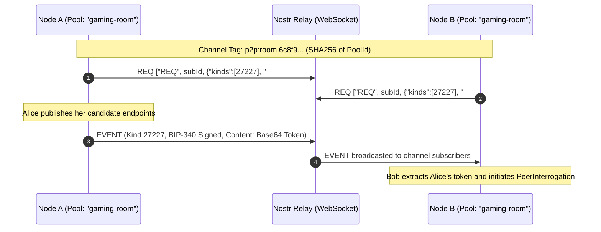

# Nostr Decentralized Signaling & BIP-340 Schnorr

> QuicPunch uses Nostr (NIP-01) for decentralized signaling. Its BIP-340 signatures and x-only ECDH are backed by NBitcoin.Secp256k1.

---

### Nostr Protocol Specification

| Property | Value |
| :--- | :--- |
| **Nostr Event Kind** | `27227` (Ephemeral P2P Signaling Event) |
| **Channel Tag** | `p2p:room:<SHA256_HEX(PoolId)>` |
| **Curve** | secp256k1 ($y^2 = x^3 + 7 \pmod p$) |
| **Signature Format** | 64-byte BIP-340 Schnorr Signature ($R_x || s$) |
| **Payload Format** | Base64-encoded encrypted token or plain candidate rendezvous |
| **Default Relays** | `wss://purplerelay.com`, `wss://nostr.oxtr.dev`, `wss://relay.primal.net`, `wss://offchain.pub`, `wss://nostr.bitcoiner.social` |

---

## BIP-340 secp256k1 implementation

[`NostrSchnorr.cs`](../../QuicPunch/Discovery/NostrSchnorr.cs) is an adapter for NBitcoin.Secp256k1 4.0.1. It retains the existing 32-byte public keys, 64-byte signatures, x-only ECDH format, and deterministic identity derivation. The derivation maps HKDF output into `(d mod (n-1)) + 1` using fixed-width arithmetic, so existing contacts keep their identities.

Secret-key point multiplication and signing no longer use the application's variable-time BigInteger curve engine. BIP-340 signatures include fresh auxiliary randomness; private key objects and temporary shared-point bytes are cleared when finished. The reliability suite checks the official fixed-message BIP-340 vectors, including invalid keys and signatures.

---

## Nostr Signaling Event Flow

Discovery announcements are published every 45 seconds, with jitter. Their signed `created_at` timestamp is valid for three minutes. The receiver retains that original UTC timestamp after validating the event and the endpoint token's certificate; receipt time and repeated or older announcements do not extend availability.

The status API exposes `discoveryAvailableUntilUtc` for discovered, saved and active contacts. A contact with a recent announcement appears as **Disponible** in the **Disponibles** group even before a direct QUIC connection exists. Expiry moves it to **Sin conexión** and updates its presence indicator without requiring a page reload. An established direct connection remains connected independently of announcement age; an ongoing connection attempt keeps its **Conectando** state.

