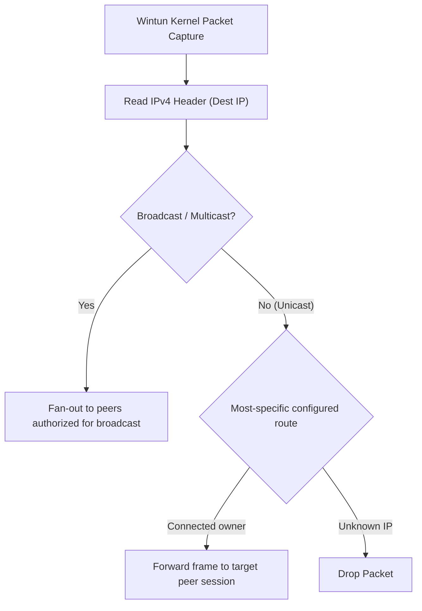

# Virtual LAN Bridge Protocol

> [`VirtualLanHandler`](../../QuicNet/Protocols/VirtualLanHandler.cs) connects authenticated peers through IPv4 virtual adapters (Wintun on Windows, TUN on Linux). See [VPN policies and orchestration](../core/vpn-policy-and-orchestration.md) for configuration, automatic sessions and the adapter broker.

---

### Protocol Specification

| Property | Value |
| :--- | :--- |
| **Protocol GUID** | `00000000-0000-0000-0000-000000000002` |
| **Tunnel Layer** | Layer 3 (IPv4 Packets) |
| **Framing** | 2-byte little-endian packet length prefix + Raw IPv4 Frame |
| **IP Allocation** | Deterministic Auto-Assignment (`10.0.0.<Host>/24`) or Manual Static IP |
| **Default MTU** | `1420` (Configurable from `1200` to `9000`) |
| **Address authorization** | Pinned to each peer's certificate identity; source, destination and route policies |

---

## Deterministic IP Assignment Algorithm

[`VirtualLanHandler.ComputeAutomaticIp`](../../QuicNet/Protocols/VirtualLanHandler.cs) derives a stable IPv4 address from the certificate identity and group. Collisions are detected and require manual resolution:

```csharp
public static IPAddress ComputeAutomaticIp(byte[] identityHash, byte[]? groupId = null)
{
    byte[] input = new byte[identityHash.Length + (groupId?.Length ?? 0)];
    identityHash.CopyTo(input, 0);
    groupId?.CopyTo(input, identityHash.Length);
    byte[] digest = SHA256.HashData(input);
    return new IPAddress(new byte[] { 10, 0, 0, (byte)(2 + BinaryPrimitives.ReadUInt32BigEndian(digest) % 250) });
}
```

---

## Packet routing and filtering

Both QUIC datagrams and the framed stream fallback validate IPv4 headers, the identity-bound source and destination ACLs. Incoming broadcasts are delivered locally. Forwarding between peers requires explicit authorization and decrements TTL. Unicast uses longest-prefix routing, retaining the configured owner even while offline or paused.


