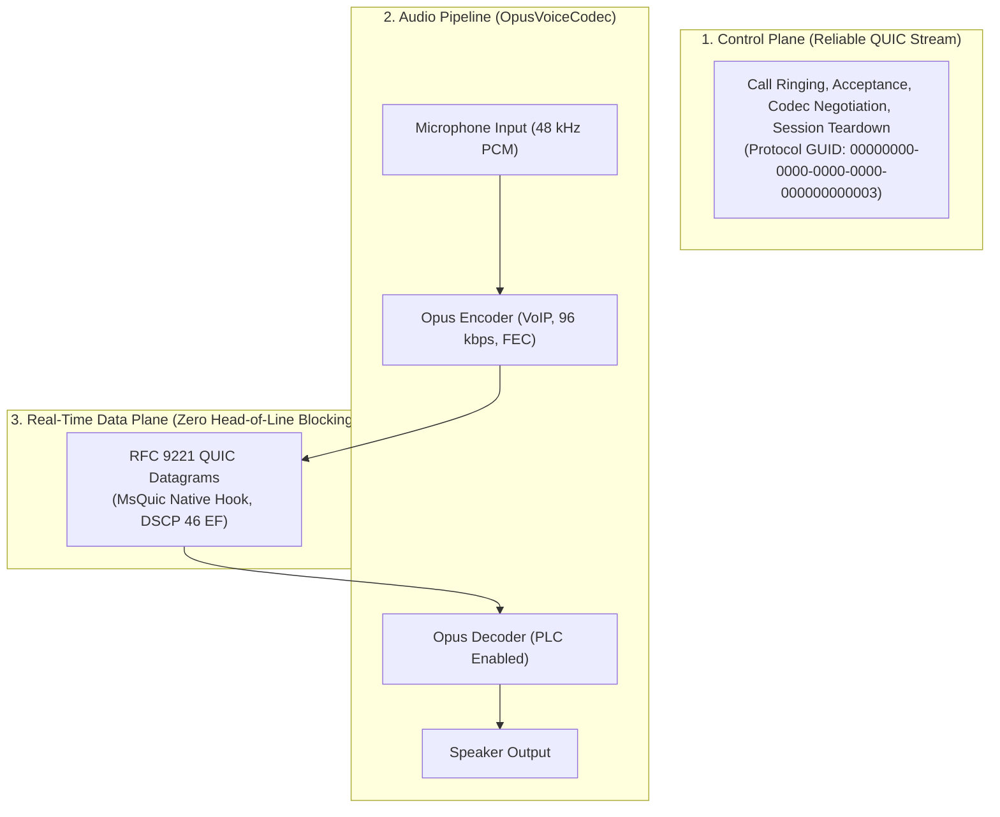

# Low-Latency Voice Call Protocol

> [`VoiceCallHandler`](../../QuicNet.Shared/Protocols/VoiceCallHandler.cs) implements a hybrid control/data plane architecture designed for real-time audio, combining RFC 9221 QUIC Datagrams with the pure C# Concentus Opus audio codec.

---

### Protocol Specification

| Property | Value | Code Definition |
| :--- | :--- | :--- |
| **Protocol GUID** | `00000000-0000-0000-0000-000000000003` | [`VoiceCallHandler.ProtocolId`](../../QuicNet.Shared/Protocols/VoiceCallHandler.cs) |
| **Protocol Name** | `VoiceCall` | [`VoiceCallHandler.ProtocolName`](../../QuicNet.Shared/Protocols/VoiceCallHandler.cs) |
| **Audio Codec** | Concentus Opus 48 kHz VoIP (`OpusVoiceCodec`) | 20ms frames, in-band FEC, 10% packet loss concealment |
| **Primary Data Plane** | RFC 9221 QUIC Datagrams (`MsQuicDatagramChannel`) | Hardware DSCP 46 (Voice EF) prioritized, unbuffered, TLS-encrypted |
| **Max Voice Frame Size** | `64 KiB` (`65,536 bytes`) | [`VoiceCallHandler`](../../QuicNet.Shared/Protocols/VoiceCallHandler.cs) |
| **Control Plane** | Reliable `QuicConnection` & `QuicStream` | Lifecycle, call signaling, keepalive, and session teardown |

---

## Dual Plane Architecture

New call/session requests allow **3 minutes** for local acceptance. Both ends of the multiplexer allow an additional 5 seconds to deliver the decision. Recovery retains its 35-second attempt limit; physical connection and heartbeat timeouts remain independent, so a failed network is still detected promptly. Starting a remote screen capture allows the same human interaction window, including choosing a source, while ordinary screen configuration commands retain their shorter deadlines. Both clients need the updated deadlines to avoid the older client's early timeout.

### Why a Hybrid Plane?
1. **Zero Head-of-Line Blocking**: In TCP and standard QUIC reliable streams, a single lost audio packet stalls all newer incoming frames until retransmitted. In real-time voice, late frames are useless and induce audible stutter.
2. **Hardware QoS Prioritization**: Under MsQuic native tuning, audio datagrams are tagged with DSCP 46 (`DscpTag.Voice_EF`), granting them top queue priority across corporate and ISP routers.
3. **Resilience with In-Band FEC**: `OpusVoiceCodec` includes forward error correction bits, allowing the receiver to reconstruct lost packets without retransmissions even over 10% packet drop networks.

## Native microphone failures and Android permissions

On Windows the mixer runs on a dedicated thread with an MMCSS `Audio` registration and a [high-resolution waitable timer](https://learn.microsoft.com/en-us/windows/win32/api/synchapi/nf-synchapi-createwaitabletimerexw). Deadlines follow a monotonic clock rather than accumulating relative waits; expired ticks are skipped after a stall. Unsupported hosts retain the standard timer. This adds no prebuffer: frames remain 20 ms and the existing three-frame queue limit is unchanged. Linux and Android keep their previous mixer scheduling. The clock is cancelled and its native resources/MMCSS registration are released when audio stops; it does not call `timeBeginPeriod` or spin-wait.

Framed Opus decoding rejects duplicates and late sequence numbers, handles 16-bit sequence wraparound, and serializes sequence checks with decoder state updates. After two seconds without an accepted packet it can resynchronize immediately without producing a backlog of concealment frames. This avoids replaying stale speech without waiting for a packet-reordering buffer. `--test-native-audio --verbose` reports old/new timing measurements on the current Windows host, tests decoder continuity and cancellation, and exercises the WinMM output with silence. These checks do not establish audible quality on a real network call.

The Android capture worker keeps its own stable AudioRecord reference; clearing the startup cleanup variable cannot invalidate the worker. Recording startup and read errors are surfaced through the audio service. The service reports capture/playback running states and errors, and checks backend startup results instead of announcing a successful microphone unconditionally. Audio device changes and microphone tests return failures to the UI; users can retry from the audio studio. Adding another participant does not restart the shared audio engine or reset the selected devices.

On Android, call acceptance, outgoing calls and microphone tests request microphone access from a user gesture before opening native capture. The trusted loopback WebView origin may request only audio/video resources; missing runtime permissions are requested and pending WebView permission requests are completed or cancelled explicitly. The temporary browser permission stream is stopped before native AudioRecord opens the microphone. Foreground-service microphone eligibility is refreshed after permission results. Live buttons reflect a failed microphone rather than saying participants can hear it.

Android keeps its foreground node/calls alive when the last WebView client disconnects; the desktop-only last-window auto-exit policy does not terminate the Android service. Explicit service shutdown still ends calls.
