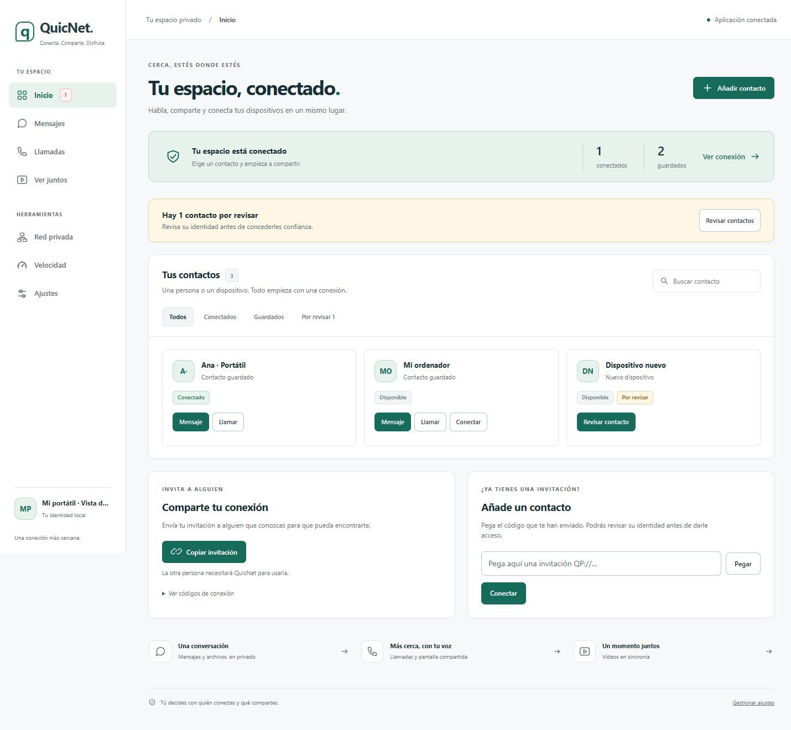

# Rediseño de QuicNet · octubre de 2026

La interfaz se organiza alrededor de las tareas habituales: encontrar un contacto, conversar, llamar, compartir vídeo y conectar equipos. Inicio presenta contactos y acciones; los detalles de red, permisos y diagnóstico están en Ajustes. La navegación mantiene siete espacios en escritorio y cinco accesos principales en móvil; Red privada y Velocidad también están accesibles desde Ajustes en móvil.

## Decisiones de diseño

- Una paleta neutra, acento verde, tipografía del sistema y componentes compartidos para todas las vistas. Tema oscuro fijo, sin fuentes externas ni nuevas dependencias de frontend.
- La barra lateral ocupa 192 px en escritorio y 176 px entre 921 y 1180 px de ventana. El modo de iconos ocupa 64 px, se activa automáticamente entre 681 y 920 px y se puede elegir con «Contraer menú» en escritorio; la elección manual se conserva. Textos, perfil e insignias caben en sus respectivos modos, y las ventanas de poca altura permiten desplazar el menú. En móvil se mantiene la navegación inferior.
- Inicio reúne contactos guardados, descubiertos y disponibles, con búsqueda, filtros, estados reales de conexión y revisión explícita de confianza. Las actualizaciones de telemetría no reconstruyen innecesariamente las tarjetas ni interrumpen su foco.
- Invitación y conexión son las dos acciones de incorporación. El portapapeles solo se lee al pulsar Pegar. Los errores se muestran junto al formulario; los botones reflejan las operaciones pendientes.
- Mensajes separa la lista de conversaciones y la conversación en móvil. Los borradores se conservan por contacto durante la sesión. La falta de un destinatario privado no selecciona automáticamente el canal público.
- Llamadas presenta primero los contactos y dispositivos. Los ajustes de vídeo habituales preceden a los ajustes técnicos plegados. Se reparó la acción Guardar cambios del diálogo de audio y se retiró un interruptor de jitter que carecía de implementación.
- Ver juntos comparte la apariencia y responde al ancho disponible. El reproductor vacío no muestra controles de un vídeo inexistente y las acciones de selección de medios reflejan si el usuario controla la sala.
- Etiquetas de campos, enlace para saltar al contenido, navegación actual anunciada, foco visible, gestión de foco y Escape en diálogos, avisos accesibles, zoom habilitado, movimiento reducido y colores forzados.

Se han tomado como referencia [los diálogos del patrón ARIA de W3C](https://www.w3.org/WAI/ARIA/apg/patterns/dialog-modal/), [la apariencia del foco](https://www.w3.org/WAI/WCAG22/Understanding/focus-appearance) y [el tamaño mínimo de objetivos](https://www.w3.org/WAI/WCAG22/Understanding/target-size-minimum). Estas mejoras no equivalen a una certificación completa WCAG. El efecto en retención necesita pruebas con usuarios reales; no se ha medido.

## Implementación

El shell está en `QuicNet.Shared/wwwroot/index.html`, las vistas en `views/`, el sistema visual en `design.css` y las estructuras especializadas en `components.css`. `experience.js` concentra la portada, el tema, la recuperación de conexión y el comportamiento compartido de accesibilidad. Los módulos existentes mantienen los protocolos de chat, llamadas, pantalla, VPN y velocidad.

La interfaz utiliza una paleta oscura fija desde CSS, también en Ver juntos. No hay selector ni preferencia de apariencia, y no se consulta la configuración de color del sistema. El servidor sirve Ajustes y los estilos como recursos embebidos.

## Copia original y restauración

Antes de modificar la interfaz se creó `backups/ui-redesign-2026-10-11/source-before-redesign.zip`: 320 archivos de código y recursos incluidos en el inventario de origen, con su estructura de carpetas. `manifest.json` contiene los SHA-256 y `git-status-before.txt` registra el estado inicial de Git. Se verificaron los 320 hashes y la integridad del ZIP.

La copia excluye Git, binarios de compilación, dependencias, carpetas de herramientas y archivos ignorados por el inventario. No es una copia de datos personales de la aplicación ni del historial de Git. Incluye los archivos originales que se modificaron para este rediseño.

Para consultar o restaurar, extraer primero el ZIP a una carpeta aparte y comparar los archivos concretos con el proyecto actual. Copiar solo los archivos que se quieran restaurar. Había cambios locales previos y hay trabajo concurrente en el repositorio: no reemplazar todo el árbol ni ejecutar un reset de Git para deshacer este rediseño. Los nuevos archivos de esta implementación no existían en el ZIP.

## Validación realizada

- Compilación de `QuicPunchTests.csproj` y sus referencias: cero errores. Permanecen seis avisos de nulabilidad en `SecurityDiscoveryTests.cs`, ajenos al rediseño.
- Suite C# `--test-webui-security`: aprobada. Incluye origen/CSRF, persistencia y validación del tema, conservación de otras preferencias, siete rutas de la SPA y recursos CSS/JS embebidos, incluidos los de Ver juntos.
- Pruebas JavaScript: navegación y privacidad de borradores, estado de contactos, vídeo, bitrate de voz, VPN y estructura de la interfaz. La estructura valida 286 IDs únicos y 54 referencias obligatorias del panel anterior.
- Comprobación de sintaxis de los módulos JavaScript.
- Navegador: escritorio a 1440 × 1000, móvil a 390 × 844 y portada a 320 × 800. Se comprobaron temas, búsqueda sin resultados, estado sin contactos, invitación vacía, selección y retorno desde una conversación, diálogo de identidad, foco al abrir/cerrar y guardado de audio, red privada, velocidad y sala de vídeo. Se corrigieron desbordamientos detectados en móvil.

La comprobación visual usa identidades y respuestas ficticias del servidor de vista previa; no inicia una VPN ni usa micrófono, contactos o invitaciones reales. No se ha realizado una prueba completa de comunicación, audio y vídeo entre dos equipos físicos con esta interfaz. Las capturas son muestras visuales, no evidencias de conectividad real.

## Ejecutar

Vista previa aislada, desde la raíz del repositorio:

```powershell
node scripts/preview-webui.mjs
# http://127.0.0.1:5099/
# Para revisar la primera experiencia: añadir --empty
# Detener con Ctrl+C al terminar.
```

Aplicación real: cerrar normalmente la instancia anterior y compilar/arrancar QuicNet de la manera habitual. Los recursos web se incrustan al compilar; recargar el navegador sin recompilar no actualiza una instancia antigua. Durante el desarrollo se mantuvo la instancia del usuario y se compiló en `.artifacts/ui-validation` para evitar sus DLL bloqueadas.

Comandos de validación:

```powershell
dotnet build QuicPunchTests/QuicPunchTests.csproj --no-restore --nologo -v quiet -o .artifacts/ui-validation
dotnet .artifacts/ui-validation/QuicPunchTests.dll --test-webui-security
Get-ChildItem QuicPunchTests/Tests/*WebTests.mjs | ForEach-Object { node $_.FullName }
```

Las pruebas C# crean certificados temporales de Windows y pueden requerir ejecución fuera del aislamiento del agente.


